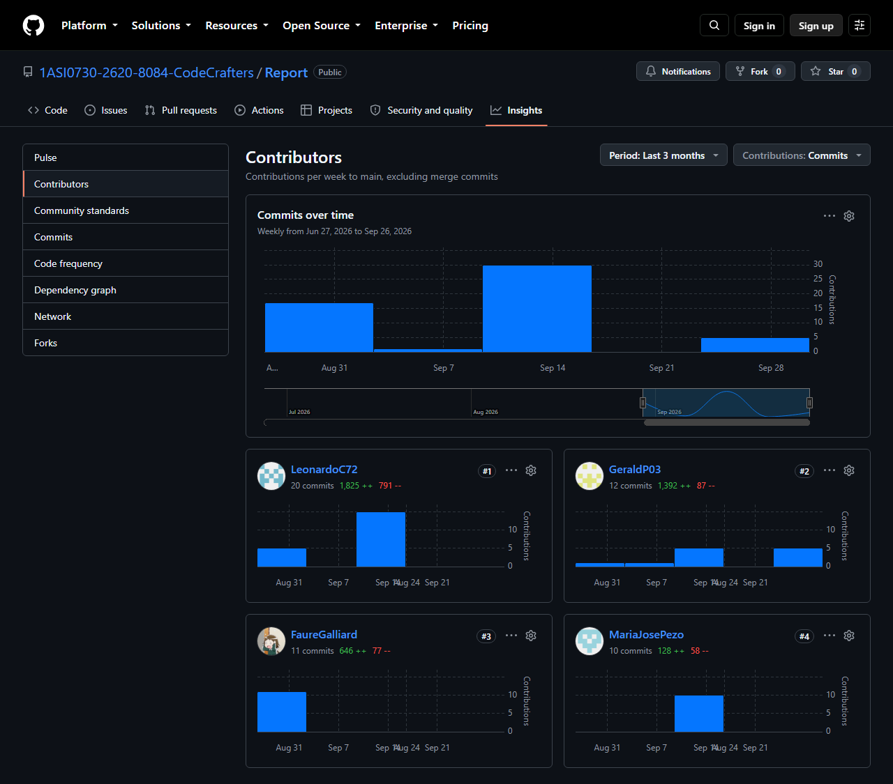

    

Universidad Peruana de Ciencias Aplicadas

Carrera de Ingeniería de Software

 

<strong>1ASI0730</strong>

<strong>Aplicaciones Web</strong>

NRC

<strong>8084</strong>

<strong>Informe del Trabajo Final</strong>

Docente

<strong>Velásquez Núñez, Ángel Augusto</strong>

 

Equipo

<strong>CodeCrafters</strong>

Proyecto

<strong>BottleTrack</strong>

 

<strong>Integrantes</strong>

<table align="center" style="width:auto;margin:4pt auto;border:none">
<tr><th style="border:none;padding:2pt 10pt;text-align:left;font-size:11pt;background:none">Código</th><th style="border:none;padding:2pt 10pt;text-align:left;font-size:11pt;background:none">Apellidos y Nombres</th></tr>
<tr><td style="border:none;padding:2pt 10pt;text-align:left;font-size:11pt">u20221g181</td><td style="border:none;padding:2pt 10pt;text-align:left;font-size:11pt">Crispin Valdivia, Angel Gabriel</td></tr>
<tr><td style="border:none;padding:2pt 10pt;text-align:left;font-size:11pt">u202311912</td><td style="border:none;padding:2pt 10pt;text-align:left;font-size:11pt">Cumba Rengifo, Leonardo Raul</td></tr>
<tr><td style="border:none;padding:2pt 10pt;text-align:left;font-size:11pt">u201819645</td><td style="border:none;padding:2pt 10pt;text-align:left;font-size:11pt">Huapaya Buitron, Ariana Alheli</td></tr>
<tr><td style="border:none;padding:2pt 10pt;text-align:left;font-size:11pt">u20211c201</td><td style="border:none;padding:2pt 10pt;text-align:left;font-size:11pt">Palacin Lazo, Gerardo Valentin</td></tr>
<tr><td style="border:none;padding:2pt 10pt;text-align:left;font-size:11pt">u20221c590</td><td style="border:none;padding:2pt 10pt;text-align:left;font-size:11pt">Pezo Castilla, Maria Jose</td></tr>
</table>

 

<strong>Período 202620</strong>

 

<strong>Octubre 2026</strong>

# **Registro de Versiones del Informe**

| Versión | Fecha | Autor | Descripción de modificación |
|:--------|:------|:------|:----------------------------|
| 1.0 | 2026-09-01 | Palacin Lazo, Gerardo Valentin | Creación del informe a partir de la plantilla del curso, con la carátula, el índice y la estructura de capítulos. |
| 1.1 | 2026-09-02 | Cumba Rengifo, Leonardo Raul | Redacción del Capítulo I, incluyendo el Startup Profile, el Solution Profile con el análisis 5W y 2H, el Lean UX Process y los segmentos objetivo. |
| 1.2 | 2026-09-02 | Cumba Rengifo, Leonardo Raul | Redacción del Capítulo II con el análisis competitivo, las estrategias frente a competidores y el diseño de entrevistas por segmento. |
| 1.3 | 2026-09-03 | Cumba Rengifo, Leonardo Raul | Redacción del Capítulo III con las Epics, User Stories, Technical Stories y el Product Backlog priorizado. |
| 1.4 | 2026-09-03 | Crispin Valdivia, Angel Gabriel | Corrección del código del curso y del nombre del profesor en la carátula, y reparación de los enlaces del índice que no resolvían. |
| 1.5 | 2026-09-03 | Crispin Valdivia, Angel Gabriel | Incorporación de las fichas de perfil de los integrantes del equipo con sus fotografías. |
| 1.6 | 2026-09-03 | Crispin Valdivia, Angel Gabriel | Redacción de las secciones 4.1 Style Guidelines y 4.2 Information Architecture del Capítulo IV. |
| 1.7 | 2026-09-03 | Crispin Valdivia, Angel Gabriel | Redacción de la sección 5.1 Software Configuration Management del Capítulo V. |
| 1.8 | 2026-09-03 | Crispin Valdivia, Angel Gabriel | Incorporación de la sección Student Outcome, el Ubiquitous Language y los Anexos del informe. |
| 1.9 | 2026-09-15 | Pezo Castilla, Maria Jose | Revisión y actualización del análisis de Needfinding, incluyendo la definición de las Personas de Usuario correspondientes a los tres segmentos objetivo: empresas distribuidoras de bebidas, supervisores o encargados de flota y bodegas o minimercados. |
| 1.10 | 2026-09-15 | Pezo Castilla, Maria Jose | Elaboración de la User Task Matrix, identificando las principales actividades realizadas por cada Persona y clasificando su frecuencia e importancia para el análisis de necesidades. |
| 1.11 | 2026-09-16 | Pezo Castilla, Maria Jose | Elaboración de los User Journey Maps AS-IS para las tres Personas de Usuario, documentando objetivos, acciones, canales de interacción, pensamientos, emociones, problemas, puntos de dolor y oportunidades de mejora del proceso actual. |
| 1.12 | 2026-09-16 | Pezo Castilla, Maria Jose | Elaboración de los Empathy Maps correspondientes a los tres segmentos objetivo, organizando la información relacionada con lo que los usuarios dicen, ven, hacen, escuchan, piensan y sienten, además de sus pains y gains. |
| 1.13 | 2026-09-17 | Pezo Castilla, Maria Jose | Desarrollo de los Impact Maps para los tres segmentos objetivo, definiendo Business Goals SMART, Actors, Impacts, Deliverables y User Stories, manteniendo la trazabilidad entre los objetivos empresariales y las necesidades identificadas. |
| 1.14 | 2026-09-17 | Pezo Castilla, Maria Jose | Documentación de los resultados del Needfinding, Impact Mapping y User Stories en el repositorio colaborativo de GitHub, organizando los contenidos para facilitar su revisión y continuidad por parte del equipo. |
| 1.15 | 2026-09-16 | Cumba Rengifo, Leonardo Raul | Incorporación de los Class Diagrams y del Database Diagram de las secciones 4.7 y 4.8. |
| 1.16 | 2026-09-18 | Palacin Lazo, Gerardo Valentin | Incorporación de los wireframes, wireflows, mock-ups y prototipo de la Web Application, y del diseño de interfaz del Landing Page. |
| 1.17 | 2026-09-18 | Pezo Castilla, Maria Jose | Incorporación del Big Picture y del Design-Level EventStorming, del registro de entrevistas y de la información de participación del Capítulo V. |
| 1.18 | 2026-09-18 | Cumba Rengifo, Leonardo Raul | Revisión del registro de entrevistas, del Sprint Planning y de las conclusiones para la entrega AV1. |
| 1.19 | 2026-10-01 | Palacin Lazo, Gerardo Valentin | Actualización del modelo C4, del Student Outcome y registro de una nueva entrevista del segmento de distribuidoras. |
| 2.0 | 2026-10-01 | Crispin Valdivia, Angel Gabriel | Corrección integral según la revisión de AV1: Lean UX con plantilla Brand new initiative y Lean UX Canvas, alineación de los segmentos objetivo, análisis de entrevistas con porcentajes, narrativa del Needfinding y del EventStorming, User Stories con Epic y nuevas historias, Product Backlog ordenado por valor, arquitectura hexagonal en el modelo C4, diagramas de clases y de base de datos en inglés, y Sprint 1 completo. |
| 2.1 | 2026-10-05 | Crispin Valdivia, Angel Gabriel | Actualización de la carátula según la guía del docente, documentación del Sprint 2 con sus evidencias de Trello, Vercel y GitHub, registro del Student Outcome de TB1, publicación del Landing Page en Netlify, fake API público en Beeceptor y registro del video de exposición de TB1. |
| 2.2 | 2026-10-05 | Cumba Rengifo, Leonardo Raul | Incorporación de los wireflows y User Flow Diagrams por User Goal del administrador y del supervisor de flota en las secciones 4.4.2 y 4.4.4. |
| 2.3 | 2026-10-05 | Cumba Rengifo, Leonardo Raul | Registro de una nueva entrevista del Segmento Objetivo 3 (Bodegas y minimarkets), actualización de su análisis de entrevistas con los nuevos porcentajes y del Anexo B con el video de Needfinding del Sprint 2. |
| 2.4 | 2026-10-05 | Palacin Lazo, Gerardo Valentin | Registro de una nueva entrevista del Segmento Objetivo 3 (Bodegas y minimarkets), con su resumen. |
| 2.5 | 2026-10-05 | Crispin Valdivia, Angel Gabriel | Incorporación de la tercera entrevista de bodegas y minimarkets al análisis de entrevistas y al Anexo B, y de los commits del informe en el Team Collaboration Insights del Sprint 2. |
| 2.6 | 2026-10-05 | Crispin Valdivia, Angel Gabriel | Corrección del resumen de la entrevista a Leo Giovany Yañez Santos del Segmento Objetivo 3. |
| 2.7 | 2026-10-05 | Pezo Castilla, Maria Jose | Actualización del Capítulo I, incorporando ajustes en la definición y alineación de los segmentos objetivo y en la información relacionada con el contexto y alcance de BottleTrack, de acuerdo con las observaciones de la revisión de AV1. |
| 2.8 | 2026-10-05 | Pezo Castilla, Maria Jose | Actualización del Capítulo II, incorporando ajustes en el análisis de Needfinding, la definición y presentación de las Personas de Usuario, User Journey Maps y Empathy Maps, asegurando la consistencia entre los segmentos objetivo y los resultados de las entrevistas. |
| 2.9 | 2026-10-05 | Pezo Castilla, Maria Jose | Actualización y consolidación del Impact Map de BottleTrack, integrando los tres segmentos objetivo en un único mapa y revisando la trazabilidad entre Business Goals, Actors, Impacts, Deliverables y User Stories. |
| 2.10 | 2026-10-05 | Huapaya Buitron, Ariana Alheli | Registro de las acciones realizadas en AV1 en la sección Student Outcome. |
| 2.11 | 2026-10-05 | Crispin Valdivia, Angel Gabriel | Incorporación en la sección Student Outcome de las acciones de TB1 realizadas en el informe por Cumba Rengifo, Palacin Lazo y Pezo Castilla. |
| 2.12 | 2026-10-05 | Crispin Valdivia, Angel Gabriel | Actualización de los commits del informe por integrante en el Team Collaboration Insights del Sprint 2. |
| 2.13 | 2026-10-05 | Crispin Valdivia, Angel Gabriel | Registro del video de exposición de TB1 en el Anexo A y en la Execution Evidence del Sprint 2. |
| 2.14 | 2026-10-05 | Crispin Valdivia, Angel Gabriel | Registro de la versión v1.0.0 del Landing Page y de la Frontend Web Application en las evidencias de desarrollo, ejecución y despliegue del Sprint 2. |

# **Project Report Collaboration Insights**

El informe se elabora de forma colaborativa en el repositorio https://github.com/1ASI0730-2620-8084-CodeCrafters/Report de la organización del equipo. Cada integrante redacta las secciones del aspecto que lidera en una rama `feature/*` creada desde `develop`, y los cambios se integran mediante pull requests o merges `--no-ff`. Los mensajes de commit siguen Conventional Commits, con el tipo `docs` y el capítulo como alcance, por ejemplo `docs(needfinding): ...`.

**AV1.** El trabajo se repartió por capítulos: Leonardo Cumba redactó los capítulos I y III y los primeros diagramas de clases y de base de datos; Maria Jose Pezo, el Needfinding, el Impact Mapping y el EventStorming; Gerardo Palacin, la plantilla del informe, el diseño de interfaces y el modelo C4; y Angel Crispin, las Style Guidelines, la arquitectura de información, la configuración del software, el Ubiquitous Language y los anexos.

**TB1.** El equipo corrigió los artefactos observados en la revisión de AV1 en la rama `feature/report-tb1-corrections`, en commits separados por sección, de modo que cada corrección puede rastrearse en el historial del repositorio.

La siguiente captura muestra los analíticos de contribución del repositorio del informe al cierre de AV1:

# **Contenido**

- [Registro de Versiones del Informe](#registro-de-versiones-del-informe)

- [Project Report Collaboration Insights](#project-report-collaboration-insights)

- [Contenido](#contenido)

- [Student Outcome](#student-outcome)

- [Capítulo I: Introducción](report/10-chapter-1-introduction.md#capitulo-i-introduccion)
    - [1.1. Startup Profile](report/10-chapter-1-introduction.md#11-startup-profile)
        - [1.1.1. Descripción de la Startup](report/10-chapter-1-introduction.md#111-descripcion-de-la-startup)
        - [1.1.2. Perfiles de integrantes del equipo](report/10-chapter-1-introduction.md#112-perfiles-de-integrantes-del-equipo)
    - [1.2. Solution Profile](report/10-chapter-1-introduction.md#12-solution-profile)
        - [1.2.1. Antecedentes y problemática](report/10-chapter-1-introduction.md#121-antecedentes-y-problematica)
        - [1.2.2. Lean UX Process.](report/10-chapter-1-introduction.md#122-lean-ux-process)
            - [1.2.2.1. Lean UX Problem Statements.](report/10-chapter-1-introduction.md#1221-lean-ux-problem-statements)
            - [1.2.2.2. Lean UX Assumptions.](report/10-chapter-1-introduction.md#1222-lean-ux-assumptions)
            - [1.2.2.3. Lean UX Hypothesis Statements.](report/10-chapter-1-introduction.md#1223-lean-ux-hypothesis-statements)
            - [1.2.2.4. Lean UX Canvas.](report/10-chapter-1-introduction.md#1224-lean-ux-canvas)
    - [1.3. Segmentos objetivo.](report/10-chapter-1-introduction.md#13-segmentos-objetivo)

- [Capítulo II: Requirements Elicitation & Analysis](report/20-chapter-2-requirements-elicitation-and-analysis.md#capitulo-ii-requirements-elicitation-analysis)
    - [2.1. Competidores.](report/20-chapter-2-requirements-elicitation-and-analysis.md#21-competidores)
        - [2.1.1. Análisis competitivo.](report/20-chapter-2-requirements-elicitation-and-analysis.md#211-analisis-competitivo)
        - [2.1.2. Estrategias y tácticas frente a competidores.](report/20-chapter-2-requirements-elicitation-and-analysis.md#212-estrategias-y-tacticas-frente-a-competidores)
    - [2.2. Entrevistas.](report/20-chapter-2-requirements-elicitation-and-analysis.md#22-entrevistas)
        - [2.2.1. Diseño de entrevistas.](report/20-chapter-2-requirements-elicitation-and-analysis.md#221-diseno-de-entrevistas)
        - [2.2.2. Registro de entrevistas.](report/20-chapter-2-requirements-elicitation-and-analysis.md#222-registro-de-entrevistas)
        - [2.2.3. Análisis de entrevistas.](report/20-chapter-2-requirements-elicitation-and-analysis.md#223-analisis-de-entrevistas)
    - [2.3. Needfinding.](report/20-chapter-2-requirements-elicitation-and-analysis.md#23-needfinding)
        - [2.3.1. User Personas.](report/20-chapter-2-requirements-elicitation-and-analysis.md#231-user-personas)
        - [2.3.2. User Task Matrix.](report/20-chapter-2-requirements-elicitation-and-analysis.md#232-user-task-matrix)
        - [2.3.3. User Journey Mapping.](report/20-chapter-2-requirements-elicitation-and-analysis.md#233-user-journey-mapping)
        - [2.3.4. Empathy Mapping.](report/20-chapter-2-requirements-elicitation-and-analysis.md#234-empathy-mapping)
    - [2.4. Big Picture EventStorming.](report/20-chapter-2-requirements-elicitation-and-analysis.md#24-big-picture-eventstorming)
    - [2.5. Ubiquitous Language.](report/20-chapter-2-requirements-elicitation-and-analysis.md#25-ubiquitous-language)

- [Capítulo III: Requirements Specification](report/30-chapter-3-requirements-specification.md#capitulo-iii-requirements-specification)
    - [3.1. User Stories.](report/30-chapter-3-requirements-specification.md#31-user-stories)
    - [3.2. Impact Mapping.](report/30-chapter-3-requirements-specification.md#32-impact-mapping)
    - [3.3. Product Backlog.](report/30-chapter-3-requirements-specification.md#33-product-backlog)

- [Capítulo IV: Product Design](report/40-chapter-4-product-design.md#capitulo-iv-product-design)
    - [4.1. Style Guidelines.](report/40-chapter-4-product-design.md#41-style-guidelines)
        - [4.1.1. General Style Guidelines.](report/40-chapter-4-product-design.md#411-general-style-guidelines)
        - [4.1.2. Web Style Guidelines.](report/40-chapter-4-product-design.md#412-web-style-guidelines)
    - [4.2. Information Architecture.](report/40-chapter-4-product-design.md#42-information-architecture)
        - [4.2.1. Organization Systems.](report/40-chapter-4-product-design.md#421-organization-systems)
        - [4.2.2. Labeling Systems.](report/40-chapter-4-product-design.md#422-labeling-systems)
        - [4.2.3. SEO Tags and Meta Tags.](report/40-chapter-4-product-design.md#423-seo-tags-and-meta-tags)
        - [4.2.4. Searching Systems.](report/40-chapter-4-product-design.md#424-searching-systems)
        - [4.2.5. Navigation Systems.](report/40-chapter-4-product-design.md#425-navigation-systems)
    - [4.3. Landing Page UI Design.](report/40-chapter-4-product-design.md#43-landing-page-ui-design)
        - [4.3.1. Landing Page Wireframe.](report/40-chapter-4-product-design.md#431-landing-page-wireframe)
        - [4.3.2. Landing Page Mock-up.](report/40-chapter-4-product-design.md#432-landing-page-mock-up)
    - [4.4. Web Applications UX/UI Design.](report/40-chapter-4-product-design.md#44-web-applications-uxui-design)
        - [4.4.1. Web Applications Wireframes.](report/40-chapter-4-product-design.md#441-web-applications-wireframes)
        - [4.4.2. Web Applications Wireflow Diagrams.](report/40-chapter-4-product-design.md#442-web-applications-wireflow-diagrams)
        - [4.4.3. Web Applications Mock-ups.](report/40-chapter-4-product-design.md#443-web-applications-mock-ups)
        - [4.4.4. Web Applications User Flow Diagrams.](report/40-chapter-4-product-design.md#444-web-applications-user-flow-diagrams)
    - [4.5. Web Applications Prototyping.](report/40-chapter-4-product-design.md#45-web-applications-prototyping)
    - [4.6. Domain-Driven Software Architecture.](report/40-chapter-4-product-design.md#46-domain-driven-software-architecture)
        - [4.6.1. Design-level Event Storming.](report/40-chapter-4-product-design.md#461-design-level-event-storming)
        - [4.6.2. Software Architecture Context Diagram.](report/40-chapter-4-product-design.md#462-software-architecture-context-diagram)
        - [4.6.3. Software Architecture Container Diagrams.](report/40-chapter-4-product-design.md#463-software-architecture-container-diagrams)
        - [4.6.4. Software Architecture Components Diagrams.](report/40-chapter-4-product-design.md#464-software-architecture-components-diagrams)
    - [4.7. Software Object-Oriented Design.](report/40-chapter-4-product-design.md#47-software-object-oriented-design)
        - [4.7.1. Class Diagrams.](report/40-chapter-4-product-design.md#471-class-diagrams)
    - [4.8. Database Design.](report/40-chapter-4-product-design.md#48-database-design)
        - [4.8.1. Database Diagrams.](report/40-chapter-4-product-design.md#481-database-diagrams)

- [Capítulo V: Product Implementation, Validation & Deployment](report/50-chapter-5-product-implementation-validation-and-deployment.md#capitulo-v-product-implementation-validation-deployment)
    - [5.1. Software Configuration Management.](report/50-chapter-5-product-implementation-validation-and-deployment.md#51-software-configuration-management)
        - [5.1.1. Software Development Environment Configuration.](report/50-chapter-5-product-implementation-validation-and-deployment.md#511-software-development-environment-configuration)
        - [5.1.2. Source Code Management.](report/50-chapter-5-product-implementation-validation-and-deployment.md#512-source-code-management)
        - [5.1.3. Source Code Style Guide and Conventions.](report/50-chapter-5-product-implementation-validation-and-deployment.md#513-source-code-style-guide-and-conventions)
        - [5.1.4. Software Deployment Configuration.](report/50-chapter-5-product-implementation-validation-and-deployment.md#514-software-deployment-configuration)
    - [5.2. Landing Page, Services & Applications Implementation.](report/50-chapter-5-product-implementation-validation-and-deployment.md#52-landing-page-services-applications-implementation)
        - [5.2.1. Sprint 1.](report/50-chapter-5-product-implementation-validation-and-deployment.md#52x-sprint-n)
            - [5.2.1.1. Sprint Planning 1.](report/50-chapter-5-product-implementation-validation-and-deployment.md#52x1-sprint-planning-n)
            - [5.2.1.2. Aspect Leaders and Collaborators.](report/50-chapter-5-product-implementation-validation-and-deployment.md#52x2-aspect-leader-and-colaborators)
            - [5.2.1.3. Sprint Backlog 1.](report/50-chapter-5-product-implementation-validation-and-deployment.md#52x3-sprint-backlog-n)
            - [5.2.1.4. Development Evidence for Sprint Review.](report/50-chapter-5-product-implementation-validation-and-deployment.md#52x4-development-evidence-for-sprint-review)
            - [5.2.1.5. Execution Evidence for Sprint Review.](report/50-chapter-5-product-implementation-validation-and-deployment.md#52x5-execution-evidence-for-sprint-review)
            - [5.2.1.6. Services Documentation Evidence for Sprint Review.](report/50-chapter-5-product-implementation-validation-and-deployment.md#52x6-services-documentation-evidence-for-sprint-review)
            - [5.2.1.7. Software Deployment Evidence for Sprint Review.](report/50-chapter-5-product-implementation-validation-and-deployment.md#52x7-software-deployment-evidence-for-sprint-review)
            - [5.2.1.8. Team Collaboration Insights during Sprint.](report/50-chapter-5-product-implementation-validation-and-deployment.md#52x8-team-colaboration-insights-during-sprint)
        - [5.2.2. Sprint 2.](report/50-chapter-5-product-implementation-validation-and-deployment.md#522-sprint-2)
            - [5.2.2.1. Sprint Planning 2.](report/50-chapter-5-product-implementation-validation-and-deployment.md#5221-sprint-planning-2)
            - [5.2.2.2. Aspect Leaders and Collaborators.](report/50-chapter-5-product-implementation-validation-and-deployment.md#5222-aspect-leaders-and-collaborators)
            - [5.2.2.3. Sprint Backlog 2.](report/50-chapter-5-product-implementation-validation-and-deployment.md#5223-sprint-backlog-2)
            - [5.2.2.4. Development Evidence for Sprint Review.](report/50-chapter-5-product-implementation-validation-and-deployment.md#5224-development-evidence-for-sprint-review)
            - [5.2.2.5. Execution Evidence for Sprint Review.](report/50-chapter-5-product-implementation-validation-and-deployment.md#5225-execution-evidence-for-sprint-review)
            - [5.2.2.6. Services Documentation Evidence for Sprint Review.](report/50-chapter-5-product-implementation-validation-and-deployment.md#5226-services-documentation-evidence-for-sprint-review)
            - [5.2.2.7. Software Deployment Evidence for Sprint Review.](report/50-chapter-5-product-implementation-validation-and-deployment.md#5227-software-deployment-evidence-for-sprint-review)
            - [5.2.2.8. Team Collaboration Insights during Sprint.](report/50-chapter-5-product-implementation-validation-and-deployment.md#5228-team-collaboration-insights-during-sprint)
    - [5.3. Validation Interviews.](report/50-chapter-5-product-implementation-validation-and-deployment.md#53-validation-interviews)
        - [5.3.1. Diseño de Entrevistas.](report/50-chapter-5-product-implementation-validation-and-deployment.md#531-diseno-de-entrevistas)
        - [5.3.2. Registro de Entrevistas.](report/50-chapter-5-product-implementation-validation-and-deployment.md#532-registro-de-entrevistas)
        - [5.3.3. Evaluaciones según heurísticas.](report/50-chapter-5-product-implementation-validation-and-deployment.md#533-evaluaciones-segun-heuristicas)
    - [5.4. Video About-the-Product.](report/50-chapter-5-product-implementation-validation-and-deployment.md#54-video-about-the-product)

- [Conclusiones](report/90-conclusions.md#conclusiones)
    - [Conclusiones y recomendaciones.](report/90-conclusions.md#conclusiones-y-recomendaciones)
    - [Video About-the-Team.](report/90-conclusions.md#video-about-the-team)

- [Bibliografía](report/99-bibliography.md#bibliografia)

- [Anexos](report/annexes/annex-a-presentation-videos.md#anexos)
    - [Anexo A. Videos de Exposiciones.](report/annexes/annex-a-presentation-videos.md#anexo-a-videos-de-exposiciones)
    - [Anexo B. Videos de Entrevistas.](report/annexes/annex-b-interview-videos.md#anexo-b-videos-de-entrevistas)
    - [Anexo C. Repositorios del Proyecto.](report/annexes/annex-c-product-links.md#anexo-c-repositorios-del-proyecto)
    - [Anexo D. Productos Desplegados.](report/annexes/annex-d-products-deployment.md#anexo-d-productos-desplegados)
    - [Anexo E. Herramientas Colaborativas.](report/annexes/annex-e-collaborative-tools.md#anexo-e-herramientas-colaborativas)
    - [Anexo F. Código Fuente de los Diagramas.](report/annexes/annex-f-diagrams-source-code.md#anexo-f-codigo-fuente-de-diagramas)

# **Student Outcome**

El curso contribuye al cumplimiento del Student Outcome ABET:

**ABET – EAC - Student Outcome 5**

Criterio: _La capacidad de funcionar efectivamente en un equipo cuyos miembros juntos proporcionan liderazgo, crean un entorno de colaboración e inclusivo, establecen objetivos, planifican tareas y cumplen objetivos._

En el siguiente cuadro se describe las acciones realizadas y enunciados de conclusiones por parte del grupo, que permiten sustentar el haber alcanzado el logro del ABET – EAC - Student Outcome 5.

| Criterio específico | Acciones realizadas                                                                                                                                                                                                                                                                                                                                                                                                                                                                                                                                                                                                                                                                                                                                                                                                                                                                                                                                                                                                                                                                                                                                                                                                                                                                                                                                                                                                                                                                                                                                                                                                                                                                                                                                                                                                                                                                                                                                                                                                                                                                                                                                                                                                                                                                                                                                                                                                                                                                                                                                                                                                                                                               | Conclusiones |
| :------------------ |:----------------------------------------------------------------------------------------------------------------------------------------------------------------------------------------------------------------------------------------------------------------------------------------------------------------------------------------------------------------------------------------------------------------------------------------------------------------------------------------------------------------------------------------------------------------------------------------------------------------------------------------------------------------------------------------------------------------------------------------------------------------------------------------------------------------------------------------------------------------------------------------------------------------------------------------------------------------------------------------------------------------------------------------------------------------------------------------------------------------------------------------------------------------------------------------------------------------------------------------------------------------------------------------------------------------------------------------------------------------------------------------------------------------------------------------------------------------------------------------------------------------------------------------------------------------------------------------------------------------------------------------------------------------------------------------------------------------------------------------------------------------------------------------------------------------------------------------------------------------------------------------------------------------------------------------------------------------------------------------------------------------------------------------------------------------------------------------------------------------------------------------------------------------------------------------------------------------------------------------------------------------------------------------------------------------------------------------------------------------------------------------------------------------------------------------------------------------------------------------------------------------------------------------------------------------------------------------------------------------------------------------------------------------------------------| :----------- |
| Trabaja en equipo para proporcionar liderazgo en forma conjunta | **Crispin Valdivia, Angel Gabriel** _AV1_ Lideró la definición del design system de BottleTrack, estableciendo la rampa de color de marca, la escala tipográfica y de espaciado, y los componentes compartidos, dejándolos documentados en una vista de style guide consultable por todo el equipo. Lideró la implementación del Landing Page en HTML5, CSS3 y JavaScript, incluyendo la internacionalización en inglés y español latinoamericano y las características de accesibilidad. Estableció el flujo de trabajo GitFlow y las convenciones de Conventional Commits y Semantic Versioning que el equipo aplica en los cuatro repositorios.  _TB1_ Lideró la configuración base de la Frontend Web Application, con Vue, PrimeVue, Pinia, vue-i18n, Vue Router, el cliente HTTP compartido y el fake API, y el bounded context Identity and Access Management. Coordinó el Sprint Planning 2, la asignación de un bounded context por integrante y la integración de las cinco ramas de feature en develop. Publicó la Web Application en Vercel y el Landing Page en Netlify, ambos en su versión v1.0.0, con las correcciones de AV1.  **Cumba Rengifo, Leonardo Raul** _AV1_ Lideró la elaboración del Solution Profile, aplicando la técnica de las 5 W y 2 H sobre el dominio del transporte de bebidas embotelladas. Condujo la ejecución del Lean UX Process, redactando el Problem Statement, los cinco tipos de assumptions y los hypothesis statements del proyecto. Lideró el análisis competitivo frente a SimpliRoute, Drivin y DispatchTrack, y la especificación de los User Stories y el Product Backlog.  _TB1_ Lideró el bounded context Operations and Routes, el de mayor alcance del Sprint 2, con la planificación, la ejecución y el historial de las operaciones de transporte. Implementó la vista de seguimiento de pedidos para el responsable de la bodega, que conecta el flujo de la distribuidora con el del punto de entrega. Documentó en el informe los wireflows y User Flow Diagrams por objetivo de usuario del administrador y del supervisor, y registró una nueva entrevista del segmento de bodegas y minimarkets.  **Palacin Lazo, Gerardo Valentin** _AV1_ Estableció la estructura base del informe del proyecto y la organización del repositorio de documentación del equipo.  _TB1_ Lideró el bounded context IoT Monitoring, con el dashboard de monitoreo de la carga, las alertas y la configuración de los rangos seguros de los dispositivos. Incorporó en el Landing Page las capturas de la aplicación en la sección del producto. Registró en el informe una nueva entrevista del segmento de bodegas y minimarkets, con la que el segmento alcanzó tres entrevistas.  **Pezo Castilla, Maria Jose** _AV1_ Lideró la ejecución del proceso de Needfinding, desarrollando y documentando los elementos correspondientes al análisis de los segmentos objetivo, incluyendo las User Personas, User Task Matrix, User Journey Maps y Empathy Maps, a partir de la información recopilada durante las entrevistas. Participó en la identificación y organización de las necesidades, comportamientos, actividades y principales dificultades de los usuarios, contribuyendo a establecer una comprensión común del dominio antes de definir la solución. Desarrolló los Impact Maps correspondientes a los segmentos objetivo, relacionando los objetivos empresariales con los actores, impactos, entregables y User Stories del producto. Participó en la especificación de User Stories, contribuyendo a transformar las necesidades identificadas durante el Needfinding en requisitos funcionales alineados con los objetivos del proyecto. Documentó los resultados del análisis y los artefactos de requisitos en el repositorio de GitHub, manteniendo organizada y trazable la información producida durante la iteración.  _TB1_ Lideró el bounded context Incident Management, con el registro, la evidencia y el seguimiento de las incidencias hasta su cierre. Implementó el dashboard de indicadores que consolida las operaciones, las entregas, las incidencias y la merma. Consolidó el Impact Map de los tres segmentos en un único mapa, con Business Goals SMART trazables hasta las User Stories, y actualizó las User Personas.  **Huapaya Buitron, Ariana Alheli** _AV1_ Aportó su visión sobre el diseño visual del producto, proponiendo ajustes en la paleta de color, la jerarquía tipográfica y la disposición de las secciones del Landing Page para que la propuesta de valor se comunicara con claridad a los tres segmentos.  _TB1_ Lideró el bounded context Fleet Management, con la gestión de vehículos y conductores que alimenta la asignación de recursos de las operaciones. | _AV1_ El equipo distribuyó el liderazgo por aspectos del proyecto en lugar de concentrarlo en una sola persona, de modo que cada integrante condujo el área en la que aportaba mayor conocimiento y colaboró en las restantes. La adopción de GitFlow y de Conventional Commits desde el primer día permitió que el liderazgo ejercido por cada integrante quedara documentado de forma verificable en el historial de los repositorios, y no solo en la percepción de los miembros. El equipo comprobó que definir un design system antes de implementar el Landing Page evitó decisiones visuales dispersas y redujo la necesidad de correcciones posteriores.  _TB1_ En el Sprint 2 el liderazgo se distribuyó por bounded context: cada integrante condujo un módulo de la Frontend Web Application de principio a fin, desde el modelo de dominio hasta las vistas. La rama de feature de cada contexto y sus commits permiten verificar en GitHub el aporte individual de cada integrante. |
| Crea un entorno colaborativo e inclusivo, establece metas, planifica tareas y cumple objetivos | **Crispin Valdivia, Angel Gabriel** _AV1_ Incorporó criterios de diseño inclusivo en el Landing Page, con atributos ARIA, texto alternativo en las imágenes, enlace de salto al contenido y respeto por la preferencia de movimiento reducido del sistema operativo. Implementó la internacionalización en inglés y español latinoamericano para que la experiencia sea accesible a los distintos perfiles de usuario de la operación. Documentó las convenciones de código y de despliegue en el informe, de manera que cualquier integrante pueda incorporarse al desarrollo sin depender de explicaciones verbales.  _TB1_ Documentó en el README del repositorio las convenciones para agregar un bounded context, de modo que cada integrante pudiera avanzar sin depender de explicaciones verbales. Mantuvo el Shared Kernel con los componentes, los design tokens y el cliente HTTP que reutilizan todos los contextos.  **Cumba Rengifo, Leonardo Raul** _AV1_ Identificó y caracterizó los segmentos objetivo del proyecto, incluyendo sus necesidades iniciales y su priorización. Diseñó las guías de entrevista diferenciadas para cada segmento, considerando el contexto particular de conductores, supervisores y distribuidoras. Estableció los criterios de priorización del Product Backlog en función del valor para el negocio.  _TB1_ Coordinó con los responsables de Fleet Management e Incident Management la asignación de recursos a las operaciones y el registro de los problemas de recepción. Completó las traducciones en inglés y español de su contexto.  **Palacin Lazo, Gerardo Valentin** _AV1_ Organizó y gestionó la elaboración del modelo C4 del negocio, y se encargó de entrevistas que permitieron delimitar al público objetivo en tres segmentos, conociendo sus puntos de dolor, metas y necesidades.  _TB1_ Coordinó con el responsable de Operations and Routes la lectura de las operaciones en curso y con la responsable de Incident Management el registro de incidencias desde las alertas.  **Pezo Castilla, Maria Jose** _AV1_ Organizó y documentó los resultados del Needfinding de manera estructurada para facilitar que los demás integrantes pudieran utilizar los hallazgos de las entrevistas como base para las siguientes etapas del proyecto. Contribuyó a establecer una visión compartida de las necesidades de los segmentos objetivo mediante la elaboración de las Personas, User Task Matrix, User Journey Maps y Empathy Maps, permitiendo al equipo contrastar las características y dificultades identificadas en los usuarios. Participó en la elaboración de los Impact Maps y User Stories, procurando mantener la trazabilidad entre los objetivos empresariales, las necesidades de los usuarios y los requisitos definidos para la solución. Mantuvo la documentación correspondiente en GitHub, permitiendo que los integrantes pudieran consultar, revisar y dar continuidad al trabajo realizado. La organización de estos artefactos permitió que el equipo avanzara de manera coordinada desde la identificación de necesidades hacia la especificación de requisitos, cumpliendo las actividades planificadas para AV1.  _TB1_ Acordó con los demás integrantes los datos que consume el dashboard, de modo que los indicadores reflejen la información de las operaciones, la flota y las incidencias.  **Huapaya Buitron, Ariana Alheli** _AV1_ Colaboró en la revisión visual de los wireframes y mock-ups del Landing Page y de la Web Application, señalando los elementos que podían resultar confusos para los usuarios y contribuyendo a una interfaz consistente entre ambos productos.  _TB1_ Entregó la información de vehículos y conductores disponibles que consume el bounded context Operations and Routes. | _AV1_ El equipo estableció como meta de la primera iteración la publicación del Landing Page y la especificación de los requisitos del producto, y organizó el trabajo en tareas asignadas a integrantes específicos para alcanzarla. El uso de un tablero de control y de ramas de feature independientes permitió que varios integrantes avanzaran en paralelo sin bloquearse entre sí. La incorporación de accesibilidad e internacionalización desde la primera versión del producto, y no como una corrección posterior, reflejó el compromiso del equipo con una solución inclusiva.  _TB1_ El equipo fijó como meta del Sprint 2 la primera versión de la Frontend Web Application y la corrección de lo observado en AV1, y la dividió en tareas por bounded context con estimación y responsable. Las cinco ramas se integraron en develop sin bloquear el trabajo de los demás, y la versión se publicó en Vercel antes del cierre del Sprint. |

---

[Capítulo I: Introducción ->](report/10-chapter-1-introduction.md)