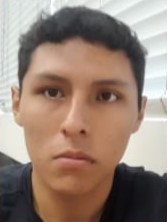
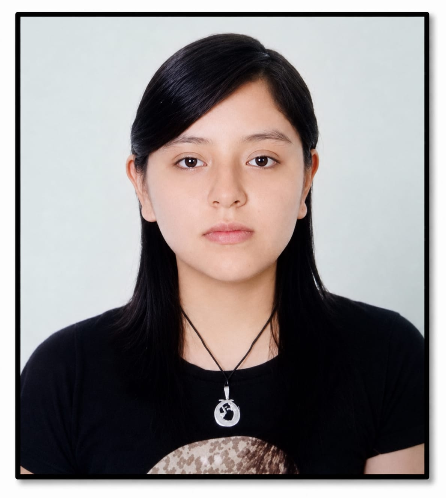

[← Student Outcome](../README.md#student-outcome) · [Contenido](../README.md#contenido) · [Capítulo II →](20-chapter-2-requirements-elicitation-and-analysis.md)

# Capítulo I: Introducción

## 1.1. Startup Profile

### 1.1.1. Descripción de la Startup

**CodeCrafters** es una startup orientada al desarrollo de soluciones tecnológicas que buscan optimizar la gestión y supervisión de procesos relacionados con el transporte y distribución de productos.

Como parte de esta iniciativa, CodeCrafters desarrolla **BottleTrack**, una plataforma web enfocada en la **gestión y seguimiento del transporte de bebidas embotelladas**. La solución permite centralizar información relacionada con vehículos, conductores, rutas, entregas e incidencias ocurridas durante el proceso de distribución.

BottleTrack está dirigida principalmente a **empresas distribuidoras de bebidas, a sus supervisores o encargados de flota y a las bodegas y minimarkets que reciben los productos**.

La plataforma busca mejorar la organización de las operaciones de transporte, facilitar el seguimiento de las entregas y permitir un mejor control de las incidencias que puedan presentarse durante la distribución.

#### Misión

Desarrollar soluciones web que permitan a las empresas distribuidoras de bebidas gestionar de manera eficiente sus operaciones de transporte, facilitando el control de vehículos, conductores, rutas, entregas e incidencias mediante una plataforma centralizada, accesible y fácil de utilizar.

#### Visión

Convertirnos en una startup tecnológica reconocida por desarrollar soluciones digitales innovadoras para la gestión del transporte y distribución, contribuyendo a que las empresas puedan optimizar sus operaciones, mejorar el seguimiento de sus entregas y tomar decisiones basadas en información confiable.

#### Modelo de Negocio

CodeCrafters plantea para BottleTrack un modelo de negocio basado en **Software as a Service (SaaS)** mediante suscripción.

Las empresas distribuidoras podrán acceder a la plataforma a través del pago de una tarifa periódica, la cual podrá variar según factores como:

* Cantidad de vehículos registrados.
* Cantidad de conductores.
* Cantidad de usuarios.
* Número de operaciones de transporte gestionadas.
* Funcionalidades disponibles dentro del plan contratado.

Este modelo permitirá ofrecer diferentes planes de servicio de acuerdo con las necesidades y el tamaño de cada empresa.

#### Público Objetivo Principal

BottleTrack está dirigido principalmente a los siguientes segmentos:

* **Empresas distribuidoras de bebidas:** organizaciones que necesitan gestionar y supervisar sus operaciones de transporte y distribución.
* **Supervisores o encargados de flota:** responsables de asignar vehículos, conductores y rutas, además de realizar el seguimiento de las operaciones.
* **Bodegas y minimarkets:** establecimientos que reciben las bebidas, consultan el estado de sus pedidos y reportan los problemas de recepción.

El principal valor diferencial de **BottleTrack** consiste en centralizar la gestión de las operaciones de transporte en una única plataforma, permitiendo conocer el estado de las entregas, registrar incidencias y mantener organizada la información relacionada con vehículos, conductores y rutas.

De esta manera, CodeCrafters busca reducir la dependencia de procesos manuales y mejorar la visibilidad y control de las operaciones de distribución de bebidas embotelladas.

### 1.1.2. Perfiles de integrantes del equipo

A continuación se presenta la ficha de cada integrante del equipo, indicando su código de estudiante, la carrera que cursa y un resumen de los principales conocimientos técnicos y habilidades que aporta al equipo.

| **Integrante**            | Palacin Lazo, Gerardo Valentin                                                                                                                                                                                                                                                                                                                                                                                                                                    |
| :------------------------ |:------------------------------------------------------------------------------------------------------------------------------------------------------------------------------------------------------------------------------------------------------------------------------------------------------------------------------------------------------------------------------------------------------------------------------------------------------------------|
| **Código del Estudiante** | U20211C201                                                                                                                                                                                                                                                                                                                                                                                                                                                        |
| **Carrera**               | Ingeniería de Software                                                                                                                                                                                                                                                                                                                                                                                                                                            |
| **Descripción**           | Me sorprenden las soluciones tecnológicas creadas a través del trabajo en equipo. Los productos de software resuelven el problema de las tareas monótonas maximizando eficiencia. Por eso sigo aprendiendo y mejorando mis habilidades de programación y tecnologías digitales. Me considero una persona curiosa y de confianza para realizar trabajos multidisciplinarios y continuo repasando conocimientos previos para no olvidarme de las buenas practicas. |
| **Foto**                  |                                                                                                                                                                                                                                                                                                                                                    |

---

| **Integrante**            | Crispin Valdivia, Angel Gabriel |
| :------------------------ | :------------------------------ |
| **Código del Estudiante** | U20221G181 |
| **Carrera**               | Ingeniería de Software |
| **Descripción**           | Soy estudiante de Ingeniería de Software y trabajo a la par de mis estudios, lo que me ha enseñado a organizar mi tiempo y a priorizar lo que realmente aporta valor. Me interesa el desarrollo frontend y el diseño de interfaces: disfruto construir design systems, cuidar la accesibilidad y lograr que un producto se vea y se comporte de forma consistente en cualquier dispositivo. Tengo experiencia con HTML, CSS y JavaScript, y con el trabajo colaborativo en Git mediante GitFlow y Conventional Commits. Me considero una persona ordenada, exigente con los detalles y comprometida con que el equipo cumpla sus entregas. |
| **Foto**                  |  |

---

| **Integrante**            | Cumba Rengifo, Leonardo Raul |
| :------------------------ | :--------------------------- |
| **Código del Estudiante** | U202311912 |
| **Carrera**               | Ingeniería de Software |
| **Descripción**           | Mi nombre es Leonardo Raul Cumba Rengifo, tengo 20 años y curso la carrera de Ingeniería de Software. Me considero una persona creativa y responsable. En mis tiempos libres me gusta aprender cosas nuevas. En este proyecto aporto todos los conocimientos que he adquirido en los últimos años. |
| **Foto**                  |  |

---

| **Integrante**            | Huapaya Buitron, Ariana Alheli |
| :------------------------ | :----------------------------- |
| **Código del Estudiante** | U201819645 |
| **Carrera**               | Ingeniería de Software |
| **Descripción**           | Soy estudiante de Ingeniería de Software y me interesa entender cómo la tecnología puede simplificar el trabajo diario de las personas. Me considero una persona perseverante, que se adapta a nuevos retos y que aprende mejor cuando trabaja en equipo. En este proyecto busco fortalecer mis conocimientos en desarrollo web y aportar en la construcción de una solución útil para el transporte de bebidas. |
| **Foto**                  |  |

---

| **Integrante**            | Pezo Castilla, Maria Jose |
| :------------------------ | :------------------------ |
| **Código del Estudiante** | U20221C590 |
| **Carrera**               | Ingeniería de Software |
| **Descripción**           | Me apasiona el desarrollo de software y me interesa seguir fortaleciendo mis conocimientos en programación y tecnologías digitales. Tengo conocimientos en Java, Python y desarrollo web, además de interés en bases de datos y computación en la nube. Me considero una persona responsable, con capacidad para aprender rápidamente y trabajar en equipo. Busco seguir desarrollando mis habilidades y afrontar nuevos retos que me permitan crecer profesionalmente. |
| **Foto**                  |  |

## 1.2. Solution Profile

BottleTrack es una plataforma web desarrollada por CodeCrafters para apoyar la gestión y seguimiento de las operaciones de transporte de bebidas embotelladas.

La solución busca centralizar la información relacionada con vehículos, conductores, rutas, puntos de entrega e incidencias, permitiendo que las empresas distribuidoras tengan una mayor visibilidad sobre el desarrollo de sus operaciones.

BottleTrack está orientado a tres segmentos: las empresas distribuidoras de bebidas, sus supervisores o encargados de flota y las bodegas y minimarkets que reciben los productos. Los conductores participan en el proceso de distribución, pero no son usuarios directos de la aplicación: el resultado de cada entrega lo registra el supervisor a partir de lo que el conductor le reporta.

### 1.2.1. Antecedentes y problemática

La distribución de bebidas embotelladas requiere la coordinación constante entre empresas distribuidoras, supervisores de flota, conductores, repartidores y establecimientos que reciben los productos.

Durante una operación de transporte se deben administrar diferentes elementos, entre ellos los vehículos disponibles, conductores asignados, rutas, puntos de entrega y el estado de cada pedido. Asimismo, pueden presentarse situaciones como retrasos, entregas incompletas, productos dañados, faltantes o problemas durante el recorrido.

Cuando la información de estas operaciones no se encuentra centralizada, los responsables pueden tener dificultades para conocer rápidamente el estado de una ruta, identificar qué entregas se realizaron correctamente o determinar si existe alguna incidencia que requiera atención.

Para comprender inicialmente la problemática se aplica la técnica **5W + 2H (Who, What, Where, When, Why, How & How Much)**.

#### Análisis 5W + 2H

| Pregunta | Descripción |
| --- | --- |
| **Who - ¿Quiénes están involucrados?** | Empresas distribuidoras de bebidas y sus administradores, supervisores o encargados de flota, y bodegas y minimarkets. Los conductores participan como fuente de la información de la ruta. |
| **What - ¿Cuál es el problema?** | Existe dificultad para centralizar y consultar el estado de las operaciones de transporte, incluyendo información de vehículos, conductores, rutas, entregas e incidencias. |
| **Where - ¿Dónde ocurre?** | Durante las operaciones de distribución de bebidas, desde la salida del vehículo hasta los diferentes puntos de entrega como bodegas y minimarkets. |
| **When - ¿Cuándo ocurre?** | Durante la planificación, ejecución y seguimiento de las operaciones de transporte y especialmente cuando se presentan retrasos, entregas incompletas u otras incidencias. |
| **Why - ¿Por qué representa un problema?** | Porque la falta de información organizada y actualizada puede dificultar la supervisión de las rutas, la comunicación entre los actores y la identificación oportuna de problemas. |
| **How - ¿Cómo se presenta el problema?** | Mediante información dispersa, necesidad de solicitar actualizaciones sobre el estado de las operaciones y dificultad para mantener un registro consolidado de las entregas e incidencias. |
| **How Much - ¿Cuál es su impacto?** | El impacto deberá ser validado mediante investigación con los segmentos objetivo. Inicialmente se considera que puede generar mayor tiempo de supervisión, retrasos en la comunicación de problemas y dificultad para analizar operaciones anteriores. |

#### Enunciado del problema

Las empresas que realizan distribución de bebidas embotelladas necesitan coordinar vehículos, conductores, rutas y múltiples puntos de entrega. Sin embargo, cuando la información relacionada con estas operaciones se encuentra dispersa o no puede ser consultada de manera centralizada, los supervisores pueden tener dificultades para conocer el avance de las rutas y responder oportunamente ante retrasos o incidencias.

Las bodegas y minimarkets, por su parte, no conocen la hora de llegada de sus pedidos y comunican los faltantes o productos dañados por WhatsApp o por teléfono, sin que quede constancia de lo ocurrido.

Esta situación genera una oportunidad para desarrollar una solución que permita organizar y mantener disponible la información relevante de las operaciones de transporte.

#### Puntos principales que debe resolver la solución

BottleTrack buscará abordar principalmente los siguientes puntos:

- Centralizar la información de vehículos, conductores y operaciones de transporte.
- Permitir la organización de rutas y puntos de entrega.
- Facilitar el seguimiento del estado de las entregas.
- Permitir el registro de incidencias ocurridas durante una operación.
- Facilitar la consulta del historial de operaciones realizadas.
- Mejorar la disponibilidad de información para los supervisores de flota y los responsables de las bodegas.

#### Objetivos de la solución

- Facilitar la gestión de vehículos y conductores utilizados en las operaciones de distribución.
- Permitir que los supervisores conozcan el estado de las rutas y entregas.
- Facilitar a los supervisores de flota el registro del resultado de cada entrega.
- Mantener un registro organizado de las incidencias ocurridas durante el transporte.
- Centralizar la información relevante de las operaciones en una plataforma web.
- Proporcionar información que pueda ser utilizada posteriormente para analizar el desempeño de las operaciones.

#### Restricciones iniciales

Para mantener un alcance viable durante el desarrollo del proyecto, se consideran inicialmente las siguientes restricciones:

- BottleTrack estará orientado principalmente al transporte de bebidas embotelladas.
- La solución será desarrollada como una aplicación web responsive.
- El proyecto se centrará inicialmente en la gestión y seguimiento de las operaciones de transporte.
- La optimización automática avanzada de rutas no formará parte del alcance inicial.
- El monitoreo con dispositivos IoT forma parte del alcance, pero durante el desarrollo las lecturas de los sensores se simulan desde el RESTful API, ya que el equipo no dispone de hardware físico.
- La plataforma no reemplazará sistemas contables, de facturación o de inventario que puedan utilizar las empresas distribuidoras.
- Las necesidades planteadas inicialmente deberán ser validadas mediante entrevistas con representantes reales de los segmentos objetivo.

---

### 1.2.2. Lean UX Process

CodeCrafters aplicará el enfoque Lean UX para identificar y validar las principales suposiciones relacionadas con BottleTrack.

Durante esta etapa se definirán las creencias iniciales del equipo sobre el negocio, los usuarios, los beneficios esperados y las funcionalidades propuestas. Estas suposiciones serán posteriormente contrastadas mediante entrevistas, prototipos, pruebas de usabilidad y el desarrollo progresivo de un Producto Mínimo Viable (MVP).

#### 1.2.2.1. Lean UX Problem Statements

BottleTrack corresponde a una nueva iniciativa, por lo que el equipo aplica la plantilla **Brand new initiative** de Lean UX y formula un único Problem Statement para todo el proyecto, considerando de forma conjunta los tres segmentos objetivo. El enunciado se construye a partir de los hallazgos del análisis 5W + 2H de la sección 1.2.1: el **Who** define los segmentos, el **What** y el **How** describen el flujo de trabajo actual y sus puntos de dolor, el **Where** y el **When** delimitan el momento en que ocurre el problema y el **How Much** se traduce en los indicadores con los que se medirá el éxito.

> **Problem Statement**
>
> El estado actual de la distribución de bebidas embotelladas en Lima se ha enfocado principalmente en que las **empresas distribuidoras** y sus **supervisores de flota** coordinen vehículos, conductores, rutas y puntos de entrega mediante hojas de cálculo, mensajes de WhatsApp y llamadas telefónicas, mientras que las **bodegas y minimarkets** reciben los pedidos sin conocer su estado ni contar con un canal formal para reportar faltantes o productos dañados.
>
> Lo que los productos y servicios existentes no logran resolver es una solución especializada y de baja complejidad para pequeñas y medianas distribuidoras: las plataformas de última milla como SimpliRoute, Drivin y DispatchTrack se concentran en la optimización de rutas para múltiples industrias, con un costo y una curva de adopción elevados, y no consideran los riesgos propios del producto embotellado, como las botellas rotas, los faltantes y la merma.
>
> Nuestro producto abordará esta brecha mediante una aplicación web responsive que centralice en un solo lugar las operaciones de transporte, el estado de cada punto de entrega, el registro de incidencias con evidencia y el monitoreo de la carga mediante dispositivos IoT, bajo un modelo de suscripción SaaS.
>
> Nuestro enfoque inicial serán los **supervisores de flota de distribuidoras pequeñas y medianas de Lima Metropolitana**, que son quienes hoy consolidan manualmente la información de la jornada, junto con los administradores de esas empresas y las bodegas que atienden.
>
> Sabremos que hemos tenido éxito cuando observemos que los supervisores consultan el estado de una operación en menos de 1 minuto sin llamar al conductor, que al menos el 80 % de las incidencias de una jornada queda registrada con evidencia en la plataforma y que el 70 % de las bodegas atendidas consulta el estado de su pedido antes de comunicarse con la distribuidora.

**Restricciones que se aplican al Problem Statement**

- El alcance se limita al transporte de bebidas embotelladas desde el centro de distribución hasta el punto de entrega; no incluye facturación, inventario ni contabilidad.
- Los usuarios de la aplicación son el administrador de la distribuidora, el supervisor de flota y el responsable de la bodega. El conductor participa del proceso, pero el registro de los resultados de la ruta lo realiza el supervisor.
- La optimización automática de rutas queda fuera del alcance; el orden de las paradas lo define el supervisor.
- Durante el desarrollo, las lecturas de los dispositivos IoT se simulan desde el RESTful API, ya que el equipo no dispone de hardware físico.
- La solución debe funcionar en navegadores de escritorio y móviles, y estar disponible en inglés y en español latinoamericano.

---

#### 1.2.2.2. Lean UX Assumptions

Las assumptions representan las creencias iniciales de CodeCrafters. Cada una se redacta de forma que pueda ser validada o refutada con un dato concreto, ya sea durante las entrevistas o durante el uso de la aplicación.

##### Business Assumptions

- Creemos que las distribuidoras pequeñas y medianas de Lima, con flotas de entre 3 y 20 vehículos, no utilizan una plataforma especializada y coordinan sus operaciones con Excel y WhatsApp.
- Creemos que el principal costo oculto de estas distribuidoras es el tiempo que el supervisor dedica a consolidar información y la merma que no queda registrada.
- Creemos que estas empresas pagarían una suscripción mensual calculada por vehículo, siempre que el costo sea inferior al de las plataformas de última milla existentes.
- Creemos que una plataforma especializada en el producto embotellado se diferencia lo suficiente de las soluciones genéricas como para justificar el cambio de herramienta.
- Creemos que las bodegas pueden convertirse en un canal de adopción: si reciben información de sus pedidos, presionarán a otras distribuidoras para que usen la misma plataforma.

##### Business Outcome Assumptions

- Creemos que BottleTrack reducirá en al menos 25 % el tiempo que el supervisor dedica a consolidar el estado de la jornada.
- Creemos que al menos el 80 % de las operaciones de las empresas piloto quedará registrado y será consultable en la plataforma durante los primeros 6 meses.
- Creemos que el porcentaje de incidencias registradas con evidencia pasará de un registro informal en WhatsApp a más del 80 % dentro de la plataforma.
- Creemos que al menos el 60 % de las empresas que completen un piloto de 3 meses contratará una suscripción.

##### User Assumptions

- Creemos que el supervisor de flota es quien más tiempo pierde, porque debe llamar o escribir a cada conductor para conocer el avance de la ruta.
- Creemos que el administrador de la distribuidora necesita indicadores consolidados y el historial de operaciones para tomar decisiones, no el detalle de cada parada.
- Creemos que el responsable de la bodega no sabe a qué hora llegará su pedido y comunica los problemas de recepción por WhatsApp o por teléfono, sin que quede constancia.
- Creemos que el supervisor alterna entre la computadora y el smartphone durante la jornada, mientras que la bodega utiliza principalmente el smartphone.

##### User Outcome and Benefit Assumptions

- Creemos que el supervisor desea saber en todo momento qué entregas se completaron, cuáles están pendientes y cuáles presentan un problema, sin depender de llamadas.
- Creemos que el administrador desea revisar el resultado de cada jornada y la merma acumulada para evaluar el desempeño de la operación.
- Creemos que el responsable de la bodega desea conocer el estado de su pedido y dejar constancia de un faltante o de un producto dañado en el momento de la recepción.
- Creemos que todos los usuarios valoran una herramienta que puedan aprender a usar en una sola jornada.

##### Feature Assumptions

- Creemos que un **módulo de gestión de flota** permitirá mantener actualizada la disponibilidad de vehículos y conductores.
- Creemos que un **módulo de operaciones y rutas** permitirá crear una operación, asignar recursos y ordenar sus puntos de entrega.
- Creemos que el **seguimiento del estado de cada punto de entrega** permitirá conocer el avance de la operación sin llamar al conductor.
- Creemos que un **módulo de incidencias con evidencia fotográfica** permitirá dejar constancia de las botellas rotas, los faltantes y los retrasos.
- Creemos que el **monitoreo IoT de la carga con alertas** permitirá detectar golpes y temperaturas fuera de rango antes de que el producto llegue dañado.
- Creemos que un **dashboard con indicadores e historial** permitirá al administrador evaluar el desempeño de las operaciones.
- Creemos que una **vista de seguimiento para la bodega** permitirá conocer el estado del pedido y reportar problemas de recepción.

---

#### 1.2.2.3. Lean UX Hypothesis Statements

Se formula un Hypothesis Statement por cada Feature Assumption, siguiendo la plantilla *We believe we will achieve [business outcome] if [personas] attain [benefit] with [feature]*. Cada uno se vincula con el indicador de éxito del Problem Statement que permitirá validarlo.

| # | Hypothesis Statement | Indicador de validación |
| :- | :------------------- | :---------------------- |
| H1 | Creemos que lograremos **reducir las operaciones que no pueden iniciarse por falta de recursos** si los **supervisores de flota** logran **conocer qué vehículos y conductores están disponibles al planificar la jornada** con un **módulo de gestión de flota**. | Porcentaje de operaciones reprogramadas por falta de recursos. |
| H2 | Creemos que lograremos que **al menos el 80 % de las operaciones de las empresas piloto quede registrado** si los **supervisores de flota** logran **crear una operación, asignar sus recursos y ordenar sus paradas en un solo lugar** con un **módulo de operaciones y rutas**. | Operaciones registradas respecto del total de operaciones de la empresa. |
| H3 | Creemos que lograremos **reducir en 25 % el tiempo dedicado a consolidar el estado de la jornada** si los **supervisores de flota** logran **conocer el avance de cada operación sin llamar al conductor** con el **seguimiento del estado de cada punto de entrega**. | Tiempo promedio para conocer el estado de una operación. |
| H4 | Creemos que lograremos que **más del 80 % de las incidencias quede registrado con evidencia** si los **supervisores de flota** logran **dejar constancia de lo ocurrido en el momento en que se reporta** con un **módulo de incidencias con evidencia fotográfica**. | Incidencias con evidencia respecto del total reportado. |
| H5 | Creemos que lograremos **reducir la merma por botellas rotas y producto dañado** si los **supervisores de flota** logran **detectar golpes y temperaturas fuera de rango durante el trayecto** con el **monitoreo IoT de la carga con alertas**. | Merma por operación antes y después del piloto. |
| H6 | Creemos que lograremos que **el 60 % de las empresas piloto contrate una suscripción** si los **administradores de las distribuidoras** logran **evaluar el desempeño y la merma de sus operaciones** con un **dashboard con indicadores e historial**. | Tasa de conversión de piloto a suscripción. |
| H7 | Creemos que lograremos **reducir las llamadas de las bodegas a la distribuidora** si los **responsables de bodegas y minimarkets** logran **conocer el estado de su pedido y reportar problemas de recepción** con una **vista de seguimiento para la bodega**. | Porcentaje de bodegas que consultan su pedido antes de llamar. |

---

#### 1.2.2.4. Lean UX Canvas

El Lean UX Canvas resume en un solo cuadro la propuesta del equipo. Cada casillero se alimenta de las secciones anteriores y de los hallazgos de las entrevistas registradas en el Capítulo II.

| Casillero | Contenido |
| :-------- | :-------- |
| **1. Business Problem** | Las distribuidoras pequeñas y medianas de bebidas embotelladas coordinan sus operaciones con Excel, WhatsApp y llamadas. La información de la jornada queda dispersa, el supervisor invierte gran parte de su tiempo en consolidarla y la merma por botellas rotas y faltantes no queda registrada. Las plataformas existentes son costosas y no están especializadas en este producto. |
| **2. Business Outcomes** | Reducir en 25 % el tiempo de consolidación del supervisor. Registrar el 80 % de las operaciones y de las incidencias en la plataforma. Convertir el 60 % de los pilotos en suscripciones. |
| **3. Users** | Carlos Mendoza, administrador de una distribuidora. Luis Torres, supervisor de operaciones y flota. María Fernández, propietaria de un minimarket. |
| **4. User Outcomes and Benefits** | Carlos revisa indicadores, merma e historial sin pedir reportes. Luis conoce el avance de cada ruta y atiende las incidencias sin llamar al conductor. María sabe cuándo llega su pedido y deja constancia de cualquier problema de recepción. |
| **5. Solutions** | Gestión de flota. Operaciones y rutas con puntos de entrega ordenados. Seguimiento del estado de cada entrega. Incidencias con evidencia fotográfica. Monitoreo IoT con alertas de golpes y temperatura. Dashboard con historial. Vista de seguimiento para la bodega. |
| **6. Hypotheses** | H1 a H7 de la sección 1.2.2.3. |
| **7. What's the most important thing we need to learn first?** | Si los supervisores registrarán el resultado de cada entrega en la plataforma en lugar de hacerlo por WhatsApp, ya que de ese registro dependen el seguimiento, el dashboard y la vista de la bodega. |
| **8. What's the least amount of work we need to do to learn the next most important thing?** | Un prototipo navegable en Figma del flujo *crear operación → actualizar entrega → registrar incidencia*, validado con los supervisores entrevistados, seguido de una primera versión de la aplicación web conectada a un API simulado con json-server. |

## 1.3. Segmentos objetivo

Los segmentos objetivo de BottleTrack se encuentran relacionados con las diferentes actividades que forman parte del proceso de distribución de bebidas embotelladas.

La definición presentada en esta etapa corresponde a una aproximación inicial realizada por CodeCrafters. Las características específicas, comportamientos y necesidades de cada segmento deberán ser posteriormente contrastadas mediante las entrevistas realizadas durante el proceso de Requirements Elicitation & Analysis.

Los segmentos objetivo son las **empresas distribuidoras de bebidas**, los **supervisores o encargados de flota** y las **bodegas o minimarkets**. Los conductores y repartidores fueron considerados en la etapa inicial, pero el equipo decidió no tratarlos como segmento: no son quienes contratan ni quienes consultan la información, y su participación queda representada por los registros que realiza el supervisor.

### Empresas distribuidoras de bebidas

Las empresas distribuidoras de bebidas constituyen el segmento organizacional al que se dirige principalmente el modelo de negocio de BottleTrack.

Estas empresas realizan operaciones que requieren trasladar productos desde almacenes o centros de distribución hacia diferentes puntos de venta. Para ello deben disponer de vehículos, conductores y personal encargado de organizar y supervisar las operaciones.

#### Características generales

- Empresas dedicadas a la distribución o comercialización de bebidas.
- Pueden administrar uno o varios vehículos destinados al reparto.
- Realizan entregas hacia diferentes establecimientos.
- Necesitan coordinar recursos humanos y vehículos para realizar las operaciones.
- Pueden realizar varias rutas o entregas durante una misma jornada.
- Representan al potencial cliente que contrataría BottleTrack bajo un modelo SaaS.

#### Necesidades iniciales identificadas

- Mantener organizada la información de las operaciones de transporte.
- Conocer el desempeño general de sus operaciones de distribución.
- Mantener información histórica de rutas, entregas e incidencias.
- Tener mayor visibilidad sobre los recursos utilizados en la distribución.

---

### Supervisores o encargados de flota

Los supervisores o encargados de flota representan uno de los principales usuarios de BottleTrack.

Son responsables de organizar y supervisar los recursos involucrados en las operaciones de transporte, tales como vehículos, conductores, rutas y puntos de entrega.

#### Características demográficas iniciales

- **Edad referencial:** 25 a 55 años.
- **Ocupación:** supervisor de transporte, encargado de distribución, encargado de flota o responsable de operaciones.
- **Entorno laboral:** empresas distribuidoras, almacenes o centros de distribución.
- **Nivel de adopción tecnológica esperado:** medio.
- **Dispositivos utilizados:** principalmente computadora y smartphone.

#### Características del segmento

- Supervisa múltiples operaciones de transporte.
- Coordina la asignación de vehículos y conductores.
- Necesita conocer el avance de las entregas.
- Atiende problemas e incidencias reportadas durante las rutas.
- Requiere información que permita determinar el estado de las operaciones bajo su responsabilidad.

#### Necesidades iniciales identificadas

- Conocer rápidamente el estado de las rutas.
- Identificar entregas pendientes o retrasadas.
- Conocer qué conductor y vehículo fueron asignados a cada operación.
- Revisar incidencias ocurridas durante el transporte.
- Consultar información histórica de las operaciones.

---

### Bodegas y minimarkets

Las bodegas y minimarkets representan establecimientos que reciben los productos transportados por las empresas distribuidoras de bebidas.

Aunque inicialmente no constituyen los principales usuarios administrativos de BottleTrack, forman parte del dominio del problema debido a que representan puntos frecuentes de entrega dentro de las operaciones de distribución.

#### Características demográficas iniciales

- **Edad referencial del responsable:** 25 a 60 años.
- **Ocupación:** propietario, administrador o encargado del establecimiento.
- **Tipo de establecimiento:** bodega, minimarket u otro comercio minorista.
- **Nivel de adopción tecnológica esperado:** bajo a medio.
- **Dispositivos utilizados:** principalmente smartphone.

#### Características del segmento

- Reciben productos provenientes de uno o varios distribuidores.
- Verifican la cantidad y estado de los productos recibidos.
- Dependiendo de la operación, pueden comunicar faltantes, daños u otros problemas.
- Requieren mantener productos disponibles para sus clientes.
- Los retrasos o problemas en las entregas pueden afectar su proceso de abastecimiento.

#### Necesidades iniciales identificadas

- Recibir las cantidades de productos esperadas.
- Recibir los productos en buenas condiciones.
- Disponer de una adecuada coordinación con los distribuidores.
- Reducir inconvenientes asociados con retrasos o entregas incompletas.

---

### Priorización inicial de los segmentos

A partir de la relación de cada segmento con las operaciones que busca soportar BottleTrack, CodeCrafters establece inicialmente la siguiente priorización:

| Segmento | Relación con BottleTrack | Prioridad inicial |
| --- | --- | --- |
| **Supervisores o encargados de flota** | Gestionan y supervisan directamente las operaciones de transporte. | Muy alta |
| **Empresas distribuidoras de bebidas** | Constituyen el cliente organizacional y potencial comprador del servicio. | Alta |
| **Bodegas y minimarkets** | Reciben los pedidos, consultan su estado y reportan los problemas de recepción. | Media |

Los **supervisores o encargados de flota** son los principales usuarios de la aplicación, debido a su participación directa en la planificación, ejecución y seguimiento de las operaciones.

Las **empresas distribuidoras de bebidas** representan principalmente al cliente organizacional de BottleTrack, mientras que las **bodegas y minimarkets** permitirán comprender desde la perspectiva del receptor los problemas que pueden presentarse durante las entregas.

Esta priorización fue contrastada con las entrevistas del Capítulo II, que confirmaron que el supervisor concentra la mayor parte de la coordinación diaria y que la bodega es la principal afectada por los retrasos y faltantes.

---

[← Student Outcome](../README.md#student-outcome) · [Contenido](../README.md#contenido) · [Capítulo II →](20-chapter-2-requirements-elicitation-and-analysis.md)