[← Capítulo I](10-chapter-1-introduction.md) · [Contenido](../README.md#contenido) · [Capítulo III →](30-chapter-3-requirements-specification.md)

# Capítulo II: Requirements Elicitation & Analysis

En este capítulo se desarrolla el proceso de levantamiento y análisis de información necesario para comprender con mayor profundidad el dominio en el que se desarrolla BottleTrack.

Para ello, CodeCrafters realizará inicialmente un análisis de soluciones existentes que compiten directa o indirectamente con la propuesta. Posteriormente, se desarrollará un proceso de investigación mediante entrevistas a representantes de los segmentos objetivo.

La información obtenida permitirá validar o corregir las suposiciones planteadas inicialmente por el equipo y servirá como base para la posterior construcción de User Personas, User Task Matrix, User Journey Maps, Empathy Maps y demás artefactos del proceso de Needfinding.

---

## 2.1. Competidores

Con la finalidad de comprender el entorno competitivo en el cual se desarrollará BottleTrack, CodeCrafters identificó tres soluciones digitales que ofrecen funcionalidades relacionadas con planificación de rutas, seguimiento de entregas, gestión de transporte y monitoreo de operaciones logísticas.

Los competidores seleccionados son:

1. **SimpliRoute**
2. **Drivin**
3. **DispatchTrack**

Estas plataformas constituyen competidores directos o parcialmente directos debido a que atienden necesidades relacionadas con la gestión de última milla, planificación de rutas, seguimiento de vehículos, control de entregas y comunicación de incidencias.

A diferencia de estas soluciones, BottleTrack plantea inicialmente un enfoque orientado a las operaciones de distribución de bebidas embotelladas, buscando ofrecer una experiencia más acotada y sencilla para empresas distribuidoras, supervisores de flota y bodegas o minimarkets.

### Competidor 1: SimpliRoute

**SimpliRoute** es una plataforma de gestión logística y última milla que permite a las empresas planificar y optimizar rutas de entrega.

Entre sus principales capacidades se encuentran la planificación de rutas con múltiples puntos de entrega, monitoreo de vehículos y conductores, seguimiento de pedidos, registro de pruebas de entrega, generación de reportes y herramientas para la gestión de flotas.

La solución dispone además de una aplicación para conductores desde la cual pueden consultar las rutas asignadas y reportar información relacionada con las entregas.

### Competidor 2: Drivin

**Drivin**, actualmente presentado como Descartes Drivin, es una plataforma SaaS de gestión de transporte (Transportation Management System - TMS).

La solución permite planificar y optimizar rutas, administrar vehículos, monitorear operaciones en tiempo real, gestionar entregas y generar reportes asociados al desempeño logístico.

Drivin también dispone de funcionalidades dirigidas a los conductores y permite integrar información proveniente de otros sistemas utilizados por las organizaciones.

### Competidor 3: DispatchTrack

**DispatchTrack** es una plataforma SaaS orientada a la gestión de operaciones de última milla.

La solución incluye optimización de rutas, seguimiento en tiempo real, aplicaciones móviles para conductores, comunicación con clientes y registro digital de evidencia de entrega mediante fotografías, firmas y notas.

DispatchTrack atiende diferentes industrias y cuenta con soluciones relacionadas específicamente con distribución de alimentos y bebidas, por lo que representa un competidor relevante para analizar dentro del dominio de BottleTrack.

---

### 2.1.1. Análisis competitivo

El análisis competitivo tiene como objetivo identificar las principales características, fortalezas y limitaciones de soluciones existentes relacionadas con la gestión de operaciones de transporte.

La pregunta que orienta este análisis es:

> **¿Cómo puede BottleTrack diferenciarse de las soluciones actuales de gestión logística y transporte para ofrecer una propuesta de valor adecuada a empresas que realizan distribución de bebidas embotelladas?**

#### Competitive Analysis Landscape

| Criterio | **BottleTrack - CodeCrafters** |  **SimpliRoute** |  **Drivin** |  **DispatchTrack** |
| --- | --- | --- | --- | --- |
| **Overview** | Plataforma web orientada a la gestión y seguimiento del transporte de bebidas embotelladas. | Plataforma de optimización de rutas y gestión de última milla. | TMS SaaS para planificación, monitoreo y gestión de operaciones de transporte. | Plataforma SaaS especializada en gestión y optimización de última milla. |
| **Ventaja competitiva** | Único enfoque específico en bebidas embotelladas: registro de botellas rotas, faltantes y merma, monitoreo IoT de golpes y temperatura de la carga, y una vista de seguimiento para la bodega que recibe el pedido. | Optimización avanzada de rutas mediante algoritmos e inteligencia artificial. | Amplio conjunto de funcionalidades para administrar integralmente operaciones de transporte. | Plataforma integral de última milla con funcionalidades especializadas para diferentes industrias, incluyendo alimentos y bebidas. |
| **Valor ofrecido al cliente** | Centralización de vehículos, conductores, rutas, entregas e incidencias en una plataforma enfocada en las necesidades del dominio. | Reducción de tiempos y recursos utilizados en la planificación y ejecución de rutas. | Mayor control y visibilidad de la operación logística desde la planificación hasta la entrega. | Gestión end-to-end de las operaciones de última milla y mejora de la visibilidad sobre las entregas. |
| **Mercado objetivo** | Empresas distribuidoras de bebidas, especialmente aquellas que requieren organizar y controlar operaciones de reparto. | Empresas que realizan operaciones de distribución y última milla. | Empresas de diferentes industrias que requieren administrar operaciones de transporte. | Distribuidores, retailers, empresas logísticas y compañías que gestionan operaciones de última milla. |
| **Estrategia de marketing** | Landing Page, demostraciones del producto, contacto directo con empresas distribuidoras y pruebas piloto. | Contenido digital, demostraciones, pruebas del producto, casos de éxito y herramientas gratuitas relacionadas con logística. | Demostraciones comerciales, casos de éxito, contenido especializado y contacto empresarial. | Demostraciones, contenido especializado, casos de clientes y estrategias B2B orientadas a distintas industrias. |
| **Productos y servicios** | Gestión de vehículos, conductores, operaciones, rutas, entregas, incidencias y dashboard de seguimiento. | Optimización de rutas, monitoreo, gestión de flota, prueba de entrega, reportes y comunicación con clientes. | Planificación y optimización de rutas, monitoreo de flota, gestión de recursos, aplicación para conductores y reportes. | Optimización de rutas, seguimiento en tiempo real, aplicación para conductores, proof of delivery, comunicación con clientes y analytics. |
| **Precios y costos** | Modelo SaaS por suscripción. La estructura final de planes y precios será validada posteriormente. | Dispone de planes por suscripción y alternativas personalizadas dependiendo del tamaño de la operación. | Modelo SaaS con pago periódico relacionado con la cantidad de vehículos utilizados. | Modelo SaaS orientado a empresas. Los precios se gestionan mediante contacto comercial y demostración. |
| **Canales de distribución** | Aplicación web responsive, Landing Page y venta directa a distribuidoras. | Plataforma web y aplicación móvil para conductores. | Plataforma web y aplicación móvil para conductores. | Plataforma web y aplicación móvil para conductores. |

---

#### Análisis SWOT

##### BottleTrack - CodeCrafters

| | |
| --- | --- |
| **Fortalezas** | Enfoque específico en distribución de bebidas embotelladas; propuesta sencilla y especializada; posibilidad de adaptar el producto a las necesidades encontradas durante las entrevistas; plataforma web responsive. |
| **Debilidades** | Producto nuevo sin clientes ni posicionamiento inicial; menor cantidad de funcionalidades que plataformas consolidadas; recursos limitados del equipo; funcionalidades avanzadas como optimización automática todavía fuera del alcance inicial. |
| **Oportunidades** | Digitalización de pequeñas y medianas operaciones de distribución; empresas que necesitan soluciones más sencillas; posibilidad de especializar funcionalidades en problemas propios de distribución de bebidas; futura incorporación de GPS, IoT y analytics. |
| **Amenazas** | Existencia de plataformas consolidadas; incorporación de nuevas funcionalidades por parte de competidores; resistencia de algunas empresas a cambiar sus procesos actuales; capacidad de competidores grandes para atender múltiples tipos de operaciones. |

##### SimpliRoute

| | |
| --- | --- |
| **Fortalezas** | Amplia experiencia en optimización de rutas; monitoreo en tiempo real; herramientas de inteligencia artificial; gestión de flota; aplicación para conductores; prueba de entrega y reportes. |
| **Debilidades** | Desde la perspectiva de BottleTrack, su amplio conjunto de funcionalidades podría representar una mayor complejidad para organizaciones que solo requieran procesos básicos de distribución. No está orientado exclusivamente al transporte de bebidas embotelladas. |
| **Oportunidades** | Crecimiento de operaciones de última milla; adopción de inteligencia artificial; integración con sistemas empresariales y expansión a nuevas industrias. |
| **Amenazas** | Competencia creciente de otras plataformas TMS y de última milla; desarrollo de soluciones especializadas para determinados sectores. |

##### Drivin

| | |
| --- | --- |
| **Fortalezas** | Plataforma TMS integral; planificación y optimización de rutas; monitoreo en tiempo real; aplicación para conductores; integración con otros sistemas y capacidad para manejar operaciones complejas. |
| **Debilidades** | Su amplitud funcional puede resultar superior a las necesidades de empresas con operaciones pequeñas; no se especializa exclusivamente en distribución de bebidas embotelladas. |
| **Oportunidades** | Crecimiento de la digitalización logística; expansión del modelo SaaS y demanda de mayor trazabilidad en las operaciones de transporte. |
| **Amenazas** | Competencia con otras plataformas globales de transporte y surgimiento de soluciones especializadas de menor complejidad. |

##### DispatchTrack

| | |
| --- | --- |
| **Fortalezas** | Amplio conjunto de herramientas de última milla; optimización de rutas; seguimiento en tiempo real; proof of delivery; aplicaciones para conductores y experiencia en industrias de alimentos y bebidas. |
| **Debilidades** | Su propuesta está orientada a una gestión amplia de última milla y puede resultar más extensa de lo requerido para una pequeña empresa distribuidora. |
| **Oportunidades** | Crecimiento del comercio y distribución de última milla; expansión de soluciones especializadas para industrias de alimentos y bebidas. |
| **Amenazas** | Competencia de plataformas regionales de TMS y optimización logística; desarrollo de herramientas especializadas para determinados mercados locales. |

---

### 2.1.2. Estrategias y tácticas frente a competidores

A partir del análisis competitivo, CodeCrafters plantea estrategias preliminares para posicionar BottleTrack frente a plataformas consolidadas como SimpliRoute, Drivin y DispatchTrack.

#### Estrategia 1: Especialización en distribución de bebidas embotelladas

BottleTrack buscará diferenciarse mediante un enfoque inicial específico en las necesidades de empresas que realizan distribución de bebidas embotelladas.

**Tácticas:**

- Diseñar los flujos de la plataforma considerando situaciones habituales de distribución de bebidas.
- Incorporar registro de incidencias relacionadas con productos dañados, botellas rotas, faltantes y entregas incompletas.
- Adaptar los términos y procesos del sistema al lenguaje utilizado por empresas distribuidoras.
- Validar las funcionalidades directamente con personas que participen en este tipo de operaciones.

#### Estrategia 2: Mantener una experiencia sencilla

En lugar de competir inicialmente por cantidad de funcionalidades, BottleTrack buscará ofrecer una experiencia enfocada en las actividades esenciales de sus usuarios.

**Tácticas:**

- Reducir la cantidad de pasos necesarios para actualizar una entrega.
- Diseñar una interfaz responsive que el supervisor y la bodega puedan usar desde el smartphone.
- Priorizar las operaciones más frecuentes identificadas durante las entrevistas.
- Evitar incorporar funcionalidades avanzadas que no hayan demostrado aportar valor a los segmentos objetivo.

#### Estrategia 3: Enfocarse inicialmente en pequeñas y medianas operaciones

Las grandes plataformas logísticas poseen capacidades para administrar operaciones de alta complejidad. BottleTrack podrá explorar una propuesta más accesible para empresas que requieren controlar una cantidad menor de vehículos, conductores y rutas.

**Tácticas:**

- Diseñar planes SaaS de acuerdo con el tamaño de la operación.
- Permitir un proceso sencillo de incorporación de empresas, vehículos y conductores.
- Realizar pruebas piloto con empresas distribuidoras pequeñas o medianas.
- Recoger retroalimentación frecuente de los usuarios para mejorar progresivamente el producto.

#### Estrategia 4: Diferenciación mediante información de incidencias

BottleTrack buscará proporcionar especial importancia al registro y seguimiento de eventos que afectan el desarrollo de las entregas.

**Tácticas:**

- Clasificar las incidencias por tipos.
- Permitir registrar descripción y evidencia del problema.
- Asociar cada incidencia con una operación y entrega específica.
- Permitir al supervisor consultar posteriormente el historial de incidencias.

#### Estrategia 5: Evolución progresiva de las capacidades tecnológicas

BottleTrack priorizará inicialmente las funcionalidades principales y dejará capacidades tecnológicas de mayor complejidad para etapas posteriores.

**Tácticas:**

- Desarrollar inicialmente gestión de recursos, rutas, entregas e incidencias.
- Evaluar posteriormente integración con GPS y servicios de mapas.
- Considerar integración con dispositivos IoT cuando las necesidades de los usuarios lo justifiquen.
- Incorporar analytics y optimización de rutas de manera progresiva.

---

## 2.2. Entrevistas

El proceso de entrevistas permitirá a CodeCrafters obtener información directamente de representantes de los segmentos objetivo de BottleTrack.

El propósito principal será comprender cómo se realizan actualmente las operaciones de distribución, identificar necesidades y frustraciones, conocer las herramientas utilizadas por los participantes y validar o refutar las assumptions formuladas durante el Lean UX Process.

Las entrevistas estarán orientadas a comprender la situación actual de los usuarios y no a confirmar que la solución propuesta por CodeCrafters es correcta.

Los segmentos considerados para las entrevistas son:

1. Empresas distribuidoras de bebidas.
2. Supervisores o encargados de flota.
3. Bodegas y minimarkets.

La información recopilada servirá posteriormente para realizar el análisis de entrevistas y construir los User Personas correspondientes a cada segmento.

### 2.2.1. Diseño de entrevistas

Las entrevistas serán de tipo semiestructurado. Se contará con un conjunto de preguntas principales previamente definido y preguntas complementarias que podrán utilizarse para profundizar en las respuestas de cada participante.

Antes de iniciar cada entrevista se solicitará autorización al participante para registrar la sesión en video con fines académicos.

Las preguntas evitarán presentar inicialmente BottleTrack o sugerir una determinada solución, debido a que el objetivo es conocer el comportamiento real de los participantes y los problemas que experimentan actualmente.

#### Información general del entrevistado

Estas preguntas se realizarán a todos los participantes y permitirán recopilar información necesaria para la posterior construcción de los User Personas.

| # | Pregunta |
| --- | --- |
| 1 | ¿Cuál es su edad? |
| 2 | ¿En qué distrito reside? |
| 3 | ¿Cuál es su ocupación y qué función realiza actualmente? |
| 4 | ¿Cuánto tiempo lleva realizando esta actividad? |
| 5 | ¿Con quiénes suele coordinar durante su jornada de trabajo? |
| 6 | ¿Qué dispositivos tecnológicos utiliza con mayor frecuencia? |
| 7 | ¿Qué aplicaciones o servicios digitales utiliza habitualmente para trabajar o comunicarse? |
| 8 | ¿Desde qué dispositivo suele acceder a estos servicios: computadora, smartphone, tablet u otro? |
| 9 | ¿Qué tan cómodo se siente utilizando nuevas aplicaciones o herramientas digitales? |
| 10 | ¿Qué es lo que más valora en una herramienta tecnológica utilizada para su trabajo? |

---

#### Entrevista - Empresas distribuidoras de bebidas

**Objetivo:** comprender cómo las empresas organizan actualmente sus operaciones de distribución, qué dificultades experimentan y qué resultados esperan obtener de sus procesos logísticos.

##### Preguntas principales

| # | Pregunta |
| --- | --- |
| 1 | Cuénteme cómo se organiza normalmente una jornada de distribución de bebidas en su empresa. |
| 2 | ¿Cómo deciden qué vehículos y conductores participarán en cada operación? |
| 3 | ¿Cómo organizan actualmente las rutas y puntos de entrega? |
| 4 | ¿Cómo conocen el estado de las entregas mientras los vehículos están realizando una ruta? |
| 5 | Cuénteme sobre la última vez que ocurrió un problema durante una entrega. ¿Qué ocurrió y cómo lo resolvieron? |
| 6 | ¿Qué información necesitan conservar después de finalizar una operación de transporte? |
| 7 | ¿Qué herramientas utilizan actualmente para gestionar o supervisar las operaciones de distribución? |
| 8 | ¿Qué parte del proceso de distribución les genera actualmente mayor dificultad o consume más tiempo? |
| 9 | ¿Cómo evalúan si una operación de distribución fue realizada correctamente? |
| 10 | ¿Qué cambios les gustaría conseguir en la manera en que actualmente gestionan sus operaciones? |

##### Preguntas complementarias

| # | Pregunta |
| --- | --- |
| 1 | ¿Con qué frecuencia realizan operaciones de distribución? |
| 2 | Aproximadamente, ¿cuántos vehículos y conductores participan en estas operaciones? |
| 3 | ¿Cuántos puntos de entrega puede atender una ruta normalmente? |
| 4 | ¿Quién necesita consultar la información generada durante las operaciones? |
| 5 | ¿Qué ocurre cuando una entrega no puede realizarse? |
| 6 | ¿Cómo manejan actualmente los productos dañados, faltantes o devoluciones? |

---

#### Entrevista - Supervisores o encargados de flota

**Objetivo:** conocer cómo los supervisores planifican y monitorean las operaciones y cuáles son sus principales dificultades para obtener información sobre vehículos, conductores, rutas y entregas.

##### Preguntas principales

| # | Pregunta |
| --- | --- |
| 1 | Cuénteme cómo comienza normalmente su jornada cuando debe organizar las operaciones de transporte. |
| 2 | ¿Cómo asigna actualmente los vehículos y conductores a una operación? |
| 3 | ¿Cómo se determinan las rutas y los puntos que debe atender cada conductor? |
| 4 | Una vez que los vehículos salen a realizar las entregas, ¿cómo conoce el avance de cada ruta? |
| 5 | ¿Qué información necesita consultar con mayor frecuencia durante una operación? |
| 6 | Cuénteme sobre una situación reciente en la que una entrega se haya retrasado o haya tenido algún inconveniente. ¿Cómo se enteró? |
| 7 | ¿Cómo registran actualmente las incidencias que ocurren durante las rutas? |
| 8 | ¿Qué información necesita revisar cuando finaliza una jornada? |
| 9 | ¿Qué actividad relacionada con la supervisión de las operaciones le consume más tiempo? |
| 10 | ¿Qué resultado le gustaría conseguir para mejorar la supervisión de las operaciones? |

##### Preguntas complementarias

| # | Pregunta |
| --- | --- |
| 1 | ¿Con cuántos conductores suele coordinar durante una jornada? |
| 2 | ¿Con qué frecuencia necesita comunicarse con los conductores durante una ruta? |
| 3 | ¿Qué medios utiliza para comunicarse con ellos? |
| 4 | ¿Qué ocurre cuando necesita consultar información de una operación realizada días o semanas atrás? |
| 5 | ¿Qué tipo de incidencia ocurre con mayor frecuencia? |
| 6 | ¿Desde qué dispositivo preferiría consultar la información de las operaciones mientras trabaja? |

---

#### Entrevista - Bodegas y minimarkets

**Objetivo:** conocer la experiencia de los establecimientos que reciben productos de las empresas distribuidoras y comprender los principales problemas relacionados con tiempos, estado y cumplimiento de las entregas.

##### Preguntas principales

| # | Pregunta |
| --- | --- |
| 1 | Cuénteme cómo realiza normalmente sus pedidos de bebidas a sus proveedores. |
| 2 | ¿Con qué frecuencia recibe entregas de bebidas en su establecimiento? |
| 3 | ¿Cómo sabe aproximadamente cuándo llegará un pedido? |
| 4 | ¿Qué hace cuando una entrega demora más de lo esperado? |
| 5 | Cuénteme sobre la última vez que recibió una entrega incompleta o con productos dañados. ¿Qué ocurrió? |
| 6 | ¿Cómo verifica que los productos recibidos coincidan con lo solicitado? |
| 7 | ¿Cómo comunica actualmente un problema relacionado con una entrega? |
| 8 | ¿Qué consecuencias tiene para su negocio recibir productos tarde o de manera incompleta? |
| 9 | ¿Qué información relacionada con una entrega considera más importante conocer? |
| 10 | ¿Qué resultado le gustaría obtener para mejorar la coordinación con sus distribuidores? |

##### Preguntas complementarias

| # | Pregunta |
| --- | --- |
| 1 | ¿Trabaja con uno o varios distribuidores de bebidas? |
| 2 | ¿Qué medios utiliza normalmente para comunicarse con ellos? |
| 3 | ¿Utiliza aplicaciones digitales para realizar o consultar pedidos? |
| 4 | ¿Desde qué dispositivo suele hacerlo? |
| 5 | ¿Con qué frecuencia encuentra diferencias entre lo solicitado y lo recibido? |
| 6 | ¿Qué considera una entrega satisfactoria? |

---

#### Información complementaria para construcción de arquetipos

Además de las respuestas relacionadas directamente con las operaciones de distribución, durante las entrevistas se buscará recopilar información que permita comprender mejor las características de cada participante.

La información considerada incluirá:

- Datos demográficos.
- Ocupación y experiencia.
- Contexto laboral.
- Personalidad y comportamiento.
- Habilidades relacionadas con su actividad.
- Herramientas y marcas tecnológicas utilizadas.
- Dispositivos de preferencia.
- Navegadores utilizados.
- Canales digitales de interacción.
- Objetivos personales relacionados con su actividad.
- Frustraciones.
- Motivaciones.
- Contexto o background del participante.

Esta información será analizada posteriormente y únicamente se utilizarán aquellas características que puedan ser respaldadas por los datos obtenidos durante las entrevistas.

---

#### Consideraciones para la realización de las entrevistas

Las entrevistas deberán realizarse con representantes reales de cada segmento objetivo. Durante la sesión el entrevistador deberá procurar que las preguntas sean abiertas y permitan al participante explicar experiencias reales.

Se evitarán preguntas que induzcan una respuesta determinada, tales como "¿Le gustaría utilizar una aplicación que haga...?". En su lugar, se priorizarán preguntas sobre experiencias anteriores, por ejemplo: "Cuénteme sobre la última vez que tuvo un problema durante una entrega".

Las entrevistas deberán registrarse en video para conservar evidencia del proceso de investigación y permitir posteriormente el análisis de las respuestas obtenidas.

### 2.2.2. Registro de entrevistas.
**Segmento Objetivo 1: Empresas distribuidoras de bebidas**

| # | Nombres y Apellidos         | Edad   | Distrito     | Screenshot                                                         | URL del video (Microsoft Stream)                                                                                                                                                                                                                                                                                                               | Inicio     | Duración |
| :--- |:----------------------------|:-------|:-------------|:-------------------------------------------------------------------|:-----------------------------------------------------------------------------------------------------------------------------------------------------------------------------------------------------------------------------------------------------------------------------------------------------------------------------------------------|:-----------|:---------|
| 1 | Luis Angel Tufiño Argüelles | 32 años | Pueblo libre |          | [Link del video](https://upcedupe-my.sharepoint.com/:v:/g/personal/u202311912_upc_edu_pe/IQCr82Alu2z7SZKNCmFaEpDPASkBq9PbtANVy94HciHpe8M?nav=eyJyZWZlcnJhbEluZm8iOnsicmVmZXJyYWxBcHAiOiJPbmVEcml2ZUZvckJ1c2luZXNzIiwicmVmZXJyYWxBcHBQbGF0Zm9ybSI6IldlYiIsInJlZmVycmFsTW9kZSI6InZpZXciLCJyZWZlcnJhbFZpZXciOiJNeUZpbGVzTGlua0NvcHkifX0&e=m3dgc1) | 00:00:00   | 11:23    |
| 2 | Luis Palacin Lope           | 51 años | Santa Anita  |  | [Link del video](https://upcedupe-my.sharepoint.com/:v:/g/personal/u20211c201_upc_edu_pe/IQBNb-6tNRj-SbxSJjcvfr6xASOZ3O2LshfMq-RH77aQrw4?e=Tqmjyc&nav=eyJyZWZlcnJhbEluZm8iOnsicmVmZXJyYWxBcHAiOiJTdHJlYW1XZWJBcHAiLCJyZWZlcnJhbFZpZXciOiJTaGFyZURpYWxvZy1MaW5rIiwicmVmZXJyYWxBcHBQbGF0Zm9ybSI6IldlYiIsInJlZmVycmFsTW9kZSI6InZpZXcifX0%3D)                                                                                                                                                                                                                                                                                                                             | 00:00:07  | 17:55    |

*Resumen de entrevista 1:*

Luis Ángel Tufiño, supervisor de distribución con 8 años de experiencia, explica que su empresa organiza diariamente los pedidos, vehículos, conductores y rutas para abastecer bodegas, minimarkets y pequeños comercios. Actualmente utilizan principalmente Excel, Google Maps, WhatsApp y llamadas telefónicas, lo que dificulta mantener la información centralizada y hacer seguimiento a varias entregas al mismo tiempo.

Los principales problemas identificados son la planificación manual de rutas, el seguimiento de los vehículos y el registro desordenado de incidencias como productos faltantes, dañados o entregas parciales. Luis considera importante contar con un sistema que permita visualizar en un solo lugar las rutas, vehículos, conductores y estado de cada entrega, además de registrar directamente si una entrega fue completada, parcial o presentó algún inconveniente.

*Resumen de entrevista 2:*

Luis Palacín, gerente de operaciones de HPL Transport con más de 20 años de experiencia, explica que su empresa coordina la disponibilidad de vehículos, asignación de servicios, conductores y rutas para transportar productos desde las plantas hacia centros de distribución y distribuidores autorizados. Actualmente utilizan principalmente Excel, WhatsApp, llamadas telefónicas y GPS (FROTCOM) para registrar información, comunicarse y monitorear la flota en tiempo real.

Los principales problemas identificados son los tiempos de espera para realizar la carga en planta y la necesidad de mantener un seguimiento constante de las unidades durante los viajes. Luis considera importante contar con herramientas que faciliten el monitoreo en tiempo real, permitan controlar los tiempos de operación y mantener información actualizada sobre las entregas. También destacó la importancia de registrar las guías, horarios, destinos y estado de cada servicio para posteriormente evaluar y liquidar las operaciones.

**Segmento Objetivo 2: Supervisores o encargados de flota**

| # | Nombres y Apellidos | Edad | Distrito | Screenshot | URL del video (Microsoft Stream) | Inicio | Duración |
| :--- | :--- | :--- | :--- | :--- | :--- | :--- | :--- |
| 1 | Rodrigo Alonso | 39 años | Miraflores |  | [Link del video](https://upcedupe-my.sharepoint.com/:v:/g/personal/u20221c590_upc_edu_pe/IQBEz4WjtPJfQ7tdUoRLgCEGARl_T6mESG_qbuhWi5Yr9u0?e=pmUB2N) | 00:00:00 | 8:39 |
| 2 | Jorge Castilla | 37 años | La Molina | 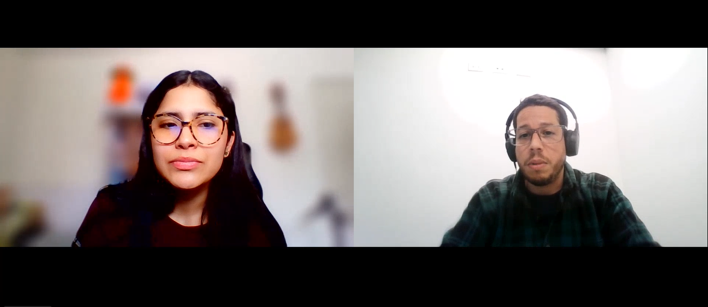 | [Link del video](https://upcedupe-my.sharepoint.com/:v:/g/personal/u20221c590_upc_edu_pe/IQA8zEtRuL5WTqnoOyQuJX5xATWNF1bk48oNO7vGYDMmLLg?e=QSsQ3y) | 00:00:00 | 11:40 |
| 3 | Pablo Ludeña Flores | 21 años | Miraflores | 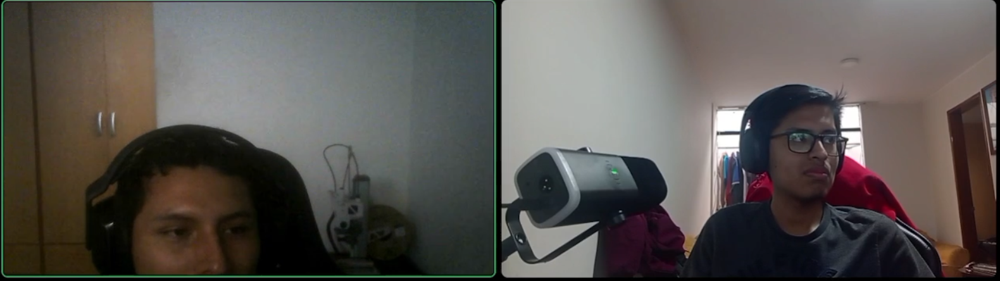 | [Link del video](https://upcedupe-my.sharepoint.com/:v:/g/personal/u202311912_upc_edu_pe/IQCANZeXFcbdQJFldztGiFupAXmK7J74aOjTF2SN9wugVdQ?nav=eyJyZWZlcnJhbEluZm8iOnsicmVmZXJyYWxBcHAiOiJPbmVEcml2ZUZvckJ1c2luZXNzIiwicmVmZXJyYWxBcHBQbGF0Zm9ybSI6IldlYiIsInJlZmVycmFsTW9kZSI6InZpZXciLCJyZWZlcnJhbFZpZXciOiJNeUZpbGVzTGlua0NvcHkifX0&e=KqzyQU) | 00:00:00 | 5:00 |

*Resumen de entrevista 1:*

Rodrigo Alonso, supervisor de operaciones y flota con siete años de experiencia, describe una jornada centrada en la planificación de entregas, asignación de vehículos y conductores, seguimiento de rutas y atención de incidencias. Actualmente utiliza principalmente Excel, WhatsApp y llamadas telefónicas para organizar y consultar información relacionada con las operaciones.
Durante la entrevista se identificó que el seguimiento de las operaciones requiere una comunicación constante con los conductores, debido a que la información sobre el avance de las entregas no se encuentra disponible de manera centralizada. Asimismo, las incidencias suelen comunicarse inicialmente mediante WhatsApp y posteriormente pueden registrarse en archivos Excel, generando información distribuida entre diferentes medios.
El entrevistado señaló que una de las actividades que mayor tiempo le demanda es recopilar información sobre el estado de las operaciones, especialmente cuando existen varios vehículos trabajando simultáneamente. También manifestó dificultades para consultar información histórica, debido a que debe revisar archivos y conversaciones anteriores. Finalmente, indicó que valora herramientas rápidas y sencillas que permiten consultar información de manera ordenada y reducir la necesidad de realizar múltiples coordinaciones.

*Resumen de entrevista 2:*

Jorge Castilla, supervisor de distribución con cinco años de experiencia en el área, describe sus principales actividades relacionadas con la organización y seguimiento de las operaciones de entrega. Durante su jornada coordina principalmente con conductores, personal de almacén y administración, utilizando WhatsApp, Excel, correo electrónico y Google Drive como herramientas de apoyo.
La entrevista permitió identificar que la planificación de las operaciones se realiza considerando la disponibilidad de vehículos y conductores, así como la ubicación y cantidad de los puntos de entrega. Una vez iniciadas las rutas, el seguimiento depende principalmente de las actualizaciones proporcionadas por los conductores mediante WhatsApp. Cuando necesita información específica, debe solicitarla directamente, debido a que no dispone de una fuente única de consulta.
Asimismo, se identificó que el registro de incidencias se realiza de manera distribuida. Las comunicaciones y fotografías pueden permanecer en WhatsApp, mientras que parte de la información se registra posteriormente en archivos Excel. Esta situación dificulta la reconstrucción de algunos eventos y la consulta de operaciones anteriores.
El entrevistado considera importante contar con información actualizada, organizada y fácil de consultar. Durante las operaciones prefiere utilizar el teléfono inteligente debido a su movilidad, mientras utiliza la computadora para revisar información más detallada.

*Resumen de entrevista 3:*

Pablo Ludeña Flores, supervisor de distribución con cinco años de experiencia en el área, explica las principales actividades que realiza para organizar y supervisar las operaciones de entrega. Durante su jornada mantiene coordinación constante con conductores, personal de almacén y personal administrativo, utilizando herramientas como WhatsApp, Excel, correo electrónico y Google Drive.

La entrevista permitió identificar que la planificación de las rutas depende principalmente de la disponibilidad de los vehículos y conductores, así como de la cantidad y ubicación de los puntos de entrega. Una vez iniciadas las operaciones, el seguimiento se realiza principalmente mediante mensajes y reportes enviados por los conductores a través de WhatsApp, por lo que muchas veces debe solicitar información directamente cuando necesita conocer el estado de una entrega.

También se identificó que la información relacionada con incidencias se encuentra distribuida en diferentes medios. Fotografías, mensajes y evidencias pueden permanecer en WhatsApp, mientras que algunos datos son registrados posteriormente en archivos de Excel, dificultando la consulta y revisión de operaciones anteriores.

Pablo considera importante contar con una herramienta que permita disponer de información actualizada, organizada y centralizada. Durante las operaciones prefiere utilizar el teléfono móvil por la facilidad de acceso, mientras que utiliza la computadora para revisar información más detallada y realizar tareas administrativas.

**Segmento Objetivo 3: Bodegas y minimarkets**

| # | Nombres y Apellidos | Edad    | Distrito     | Screenshot                                                                    | URL del video (Microsoft Stream) | Inicio   | Duración |
|:--| :--- |:--------|:-------------|:------------------------------------------------------------------------------| :--- |:---------|:---------|
| 1 | Arturo Axel Saravia Huaricancha | 20 años | Los Olivos   |                 | [Link del video](https://upcedupe-my.sharepoint.com/:v:/g/personal/u202311912_upc_edu_pe/IQAP-k4Zr1FKRpVP6YNhIdtoAWEK4ETOrCSKD40I474akTU?nav=eyJyZWZlcnJhbEluZm8iOnsicmVmZXJyYWxBcHAiOiJPbmVEcml2ZUZvckJ1c2luZXNzIiwicmVmZXJyYWxBcHBQbGF0Zm9ybSI6IldlYiIsInJlZmVycmFsTW9kZSI6InZpZXciLCJyZWZlcnJhbFZpZXciOiJNeUZpbGVzTGlua0NvcHkifX0&e=7FiX5J) | 00:00:00 | 6:06     |
| 2 | Leo Giovany Yañez Santos | 23 años | Pueblo Libre |  | [Link del video](https://upcedupe-my.sharepoint.com/:v:/g/personal/u202311912_upc_edu_pe/IQBojonPPXthQZqzYym1KU4AAaZRMaqOFJhhf7FbnKeIYyU?nav=eyJyZWZlcnJhbEluZm8iOnsicmVmZXJyYWxBcHAiOiJPbmVEcml2ZUZvckJ1c2luZXNzIiwicmVmZXJyYWxBcHBQbGF0Zm9ybSI6IldlYiIsInJlZmVycmFsTW9kZSI6InZpZXciLCJyZWZlcnJhbFZpZXciOiJNeUZpbGVzTGlua0NvcHkifX0&e=J1wLT6) | 00:00:00 | 03:00    |
| 3 | Alma Rosa Rodríguez Chota | 36 años  | Santa Anita  |           | [Link del video](https://upcedupe-my.sharepoint.com/:v:/g/personal/u20211c201_upc_edu_pe/IQB1G5FzKF5WTI8rIznLyzZXARsgezdS_X1Mothtyj9vjKo?nav=eyJyZWZlcnJhbEluZm8iOnsicmVmZXJyYWxBcHAiOiJPbmVEcml2ZUZvckJ1c2luZXNzIiwicmVmZXJyYWxBcHBQbGF0Zm9ybSI6IldlYiIsInJlZmVycmFsTW9kZSI6InZpZXciLCJyZWZlcnJhbFZpZXciOiJNeUZpbGVzTGlua0NvcHkifX0&e=fUwC72) | 00:03:00 | 11:32     |

*Resumen de entrevista 1:*

En esta entrevista, el participante es un estudiante universitario que trabaja medio tiempo durante sus vacaciones en una bodega, donde ayuda atendiendo clientes, revisando stock y recibiendo pedidos de los proveedores.

Se identificó que la bodega trabaja con varios distribuidores y que la comunicación se realiza principalmente mediante WhatsApp y llamadas. Uno de los principales problemas es no conocer con precisión la hora de llegada de los pedidos, además de recibir ocasionalmente productos incompletos o con diferencias respecto a lo solicitado.

El entrevistado considera importante poder conocer el estado del pedido, la cantidad de productos, la hora aproximada de llegada y posibles retrasos, ya que esto permitiría organizarse mejor y reducir la necesidad de estar contactando constantemente al proveedor.

*Resumen de entrevista 2:*

En esta entrevista, el participante es Leo Giovany Yañez Santos, de 23 años, encargado de un minimarket, quien realiza sus pedidos de bebidas por WhatsApp o mediante un vendedor.

Se identificó que sus principales problemas son los retrasos, los productos faltantes y la falta de una hora precisa de entrega, situaciones que afectan sus ventas y la organización del negocio.

El entrevistado considera que BottleTrack le ayudaría a consultar el estado de sus pedidos, recibir avisos y reportar incidencias con fotos, siempre que la herramienta sea fácil de usar desde el celular.

*Resumen de entrevista 3:*

En esta entrevista, la participante es Alma Rosa Rodríguez Chota, de 36 años, quien trabaja desde hace 8 años en una bodega en Santa Anita, donde realiza compras y coordina con proveedores y distribuidores. Utiliza principalmente un celular Android, WhatsApp y llamadas para comunicarse, además de Excel para controlar sus pedidos.

Se identificó que trabaja con varios proveedores y que sus principales problemas son los retrasos, productos faltantes o dañados y no conocer con precisión la hora de llegada de los pedidos. Para verificar las entregas, revisa las cantidades solicitadas y utiliza fotografías como evidencia cuando necesita realizar un reclamo.

La entrevistada considera importante conocer rápidamente el estado del pedido, las cantidades, disponibilidad y hora de llegada, ya que los problemas en las entregas pueden ocasionarle pérdida de ventas y tiempo de atención a sus clientes. Para ella, una entrega satisfactoria debe ser rápida, completa, puntual y con productos en buenas condiciones.

### 2.2.3. Análisis de entrevistas.

El análisis se realizó por segmento objetivo. Para cada uno, el equipo definió un conjunto de variables a partir de las preguntas de la guía de la sección 2.2.1 y contabilizó cuántos entrevistados manifestaron cada valor. Los porcentajes se calculan sobre el total de entrevistados del segmento. Estos resultados son la base de las características asignadas a cada User Persona en la sección 2.3.1.

Las variables analizadas son las siguientes:

| Variable | Pregunta de origen | Uso en el User Persona |
| :------- | :----------------- | :--------------------- |
| Edad y distrito | Información general, preguntas 1 y 2 | Demographic |
| Experiencia en la actividad | Información general, pregunta 4 | Demographic y Background |
| Herramientas y canales utilizados | Información general, preguntas 6 a 8 | Technology y Channels |
| Forma de conocer el avance de las entregas | Preguntas principales del segmento | Scenario |
| Forma de registrar las incidencias | Preguntas principales del segmento | Frustrations |
| Principal dificultad mencionada | Preguntas principales del segmento | Frustrations |
| Necesidad principal expresada | Pregunta de cierre del segmento | Goals y Key Needs |

#### Segmento Objetivo 1: Empresas distribuidoras de bebidas

Se entrevistó a 2 personas: un supervisor de distribución de 32 años con 8 años de experiencia y un gerente de operaciones de 51 años con más de 20 años de experiencia. Ambos tienen responsabilidad sobre la operación completa de la empresa y no solo sobre una ruta.

| Variable | Resultado | Entrevistados | % |
| :------- | :-------- | :-----------: | :-: |
| Herramientas utilizadas | Excel | 2 de 2 | 100 % |
| | WhatsApp y llamadas telefónicas | 2 de 2 | 100 % |
| | Google Maps | 1 de 2 | 50 % |
| | GPS de un proveedor externo (Frotcom) | 1 de 2 | 50 % |
| Forma de conocer el avance | Mensajes y llamadas con los conductores | 2 de 2 | 100 % |
| Principal dificultad | Seguimiento de los vehículos y entregas en curso | 2 de 2 | 100 % |
| | Planificación manual de rutas | 1 de 2 | 50 % |
| | Registro desordenado de incidencias | 1 de 2 | 50 % |
| Necesidad principal | Ver en un solo lugar el estado de cada operación y entrega | 2 de 2 | 100 % |
| | Conservar el registro de guías, horarios y destinos para evaluar la operación | 1 de 2 | 50 % |

**Conclusión del segmento.** El 100 % de los entrevistados combina Excel con WhatsApp y llamadas, y ninguno cuenta con un único lugar donde consultar el estado de la operación. La necesidad que comparten es la visibilidad centralizada, más que la optimización de rutas, lo que confirma la estrategia de diferenciación de la sección 2.1.2. Estos hallazgos se reflejan en el User Persona Carlos Mendoza: administrador con más de 10 años de experiencia, cuyos canales son WhatsApp, correo y teléfono, y cuya frustración principal es la información distribuida en diferentes medios.

#### Segmento Objetivo 2: Supervisores o encargados de flota

Se entrevistó a 3 supervisores, de 21, 37 y 39 años, con entre 5 y 7 años de experiencia, que residen en Miraflores y La Molina.

| Variable | Resultado | Entrevistados | % |
| :------- | :-------- | :-----------: | :-: |
| Herramientas utilizadas | WhatsApp | 3 de 3 | 100 % |
| | Excel | 3 de 3 | 100 % |
| | Correo electrónico y Google Drive | 2 de 3 | 67 % |
| | Llamadas telefónicas | 1 de 3 | 33 % |
| Forma de conocer el avance | Depende de los mensajes que envían los conductores | 3 de 3 | 100 % |
| Forma de registrar las incidencias | Primero en WhatsApp y después en Excel | 3 de 3 | 100 % |
| Principal dificultad | Recopilar el estado de varias operaciones simultáneas | 3 de 3 | 100 % |
| | Consultar operaciones anteriores | 3 de 3 | 100 % |
| Dispositivo preferido | Smartphone durante la operación y computadora para el detalle | 2 de 3 | 67 % |
| Necesidad principal | Información actualizada, ordenada y en un solo lugar | 3 de 3 | 100 % |

**Conclusión del segmento.** Es el segmento con el dolor más claro y homogéneo: el 100 % depende de los mensajes del conductor para conocer el avance, el 100 % registra las incidencias en dos medios distintos y el 100 % tiene dificultades para consultar el historial. El 67 % alterna entre el smartphone y la computadora, por lo que la aplicación debe ser responsive. Estos resultados sustentan al User Persona Luis Torres, de 34 años y 8 años de experiencia, que utiliza smartphone, laptop y computadora de escritorio, y cuya cita resume la necesidad del segmento: saber qué entregas se hicieron, cuáles faltan y cuáles tienen un problema.

#### Segmento Objetivo 3: Bodegas y minimarkets

Se entrevistó a 3 personas de 20, 23 y 36 años, residentes en Los Olivos, Pueblo Libre y Santa Anita: una persona que atiende una bodega, recibe los pedidos de los proveedores y revisa el stock; el encargado de un minimarket, que realiza los pedidos de bebidas; y la responsable de compras de una bodega, que coordina con proveedores y distribuidores desde hace 8 años.

| Variable | Resultado | Entrevistados | % |
| :------- | :-------- | :-----------: | :-: |
| Cantidad de distribuidores | Trabaja con varios distribuidores | 2 de 3 | 67 % |
| Canales utilizados | WhatsApp | 3 de 3 | 100 % |
| | Llamadas telefónicas | 2 de 3 | 67 % |
| | Pedido mediante un vendedor | 1 de 3 | 33 % |
| Principal dificultad | No conocer la hora de llegada del pedido | 3 de 3 | 100 % |
| | Recibir productos incompletos, dañados o distintos a lo solicitado | 3 de 3 | 100 % |
| | Retrasos en la entrega del pedido | 2 de 3 | 67 % |
| Dispositivo preferido | Celular, con una herramienta fácil de usar | 2 de 3 | 67 % |
| Necesidad principal | Consultar el estado del pedido | 3 de 3 | 100 % |
| | Conocer la cantidad y la hora aproximada de llegada | 2 de 3 | 67 % |
| | Reportar incidencias con fotos como evidencia | 2 de 3 | 67 % |
| | Recibir avisos sobre sus pedidos | 1 de 3 | 33 % |

**Conclusión del segmento.** El 100 % de los entrevistados señala como problemas principales no conocer la hora de llegada del pedido y recibir productos faltantes o dañados, y el 100 % coordina sus pedidos por WhatsApp, complementado con llamadas o con un vendedor. La necesidad que comparten es consultar el estado del pedido; además, dos de cada tres usan fotografías como evidencia para reclamar y prefieren una herramienta desde el celular, por lo que la vista para la bodega debe ser simple, adaptada al móvil y permitir reportar problemas de recepción con evidencia. Estos hallazgos dan origen al User Persona María Fernández y a la vista de seguimiento para la bodega planteada en la hipótesis H7. Con dos entrevistas, este segmento sigue teniendo la menor muestra del estudio, por lo que el equipo continúa ampliando su registro para confirmar estos porcentajes.

#### Hallazgos transversales

| Hallazgo | Segmentos en los que aparece |
| :------- | :--------------------------- |
| WhatsApp es el canal principal de coordinación y de reporte de incidencias. | 1, 2 y 3 |
| El estado de la operación se conoce solo si alguien lo comunica, no porque esté registrado. | 1, 2 y 3 |
| Las incidencias quedan repartidas entre conversaciones y hojas de cálculo. | 1 y 2 |
| Consultar operaciones pasadas exige revisar archivos y chats antiguos. | 1 y 2 |
| Ningún entrevistado mencionó la optimización automática de rutas como su necesidad principal. | 1, 2 y 3 |

## 2.3. Needfinding.
El proceso de Needfinding permite identificar y sintetizar las principales necesidades, objetivos, comportamientos, dificultades y motivaciones de los segmentos objetivo de BottleTrack. Para ello, se consideran los resultados obtenidos mediante las entrevistas realizadas a representantes de los segmentos y el análisis previo del dominio y de las soluciones existentes.

A partir de la información recolectada se identificaron tres segmentos objetivo: empresas distribuidoras de bebidas, supervisores o encargados de flota, y bodegas y minimercados. Cada segmento presenta una participación diferente dentro del proceso de distribución de bebidas, por lo que sus necesidades y actividades se analizan de manera diferenciada.

Los resultados del proceso se representan mediante tres User Personas, un User Task Matrix, tres User Journey Maps en su escenario As-Is y tres Empathy Maps. Los User Personas, User Journey Maps y Empathy Maps fueron elaborados en UXPressia, mientras que el User Task Matrix fue elaborado en Canva.

Estos artefactos permiten consolidar los hallazgos de la investigación y establecer una comprensión común de los usuarios antes de definir los requisitos funcionales de BottleTrack. En particular, los User Journey Maps representan el proceso actual de cada segmento sin la existencia de la solución propuesta, permitiendo identificar los principales puntos de dolor y oportunidades de mejora.

### 2.3.1. User Personas.

Cada User Persona representa a un segmento objetivo y se construyó con los valores más frecuentes de las variables analizadas en la sección 2.2.3. Los datos demográficos, los canales y las frustraciones provienen de lo que repitieron los entrevistados de cada segmento, y no de suposiciones del equipo.

#### User Persona del Segmento Objetivo 1: Empresas distribuidoras de bebidas

Carlos Mendoza, de 42 años, administra una distribuidora de bebidas en Ate y tiene 12 años en el rubro. Representa al cliente que contrata BottleTrack. Su objetivo es tener visibilidad del estado de las entregas y un historial confiable para tomar decisiones, y su principal frustración es que la información de la operación está repartida entre distintos medios, tal como lo indicó el 100 % de los entrevistados del segmento.

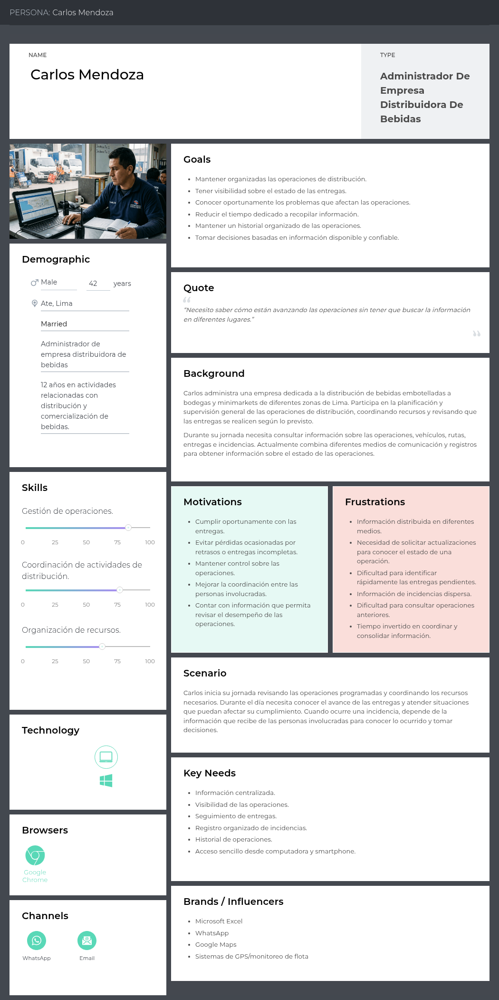

Ver en UXPressia: https://uxpressia.com/w/v8FzI/p/GS0Vk

#### User Persona del Segmento Objetivo 2: Supervisores o encargados de flota

Luis Torres, de 34 años, es supervisor de operaciones y encargado de flota en San Martín de Porres, con 8 años de experiencia. Es el usuario principal de la aplicación. Coordina la jornada desde la computadora y el smartphone, depende de los mensajes de WhatsApp para conocer el avance de las rutas y necesita identificar rápidamente las entregas con problemas.

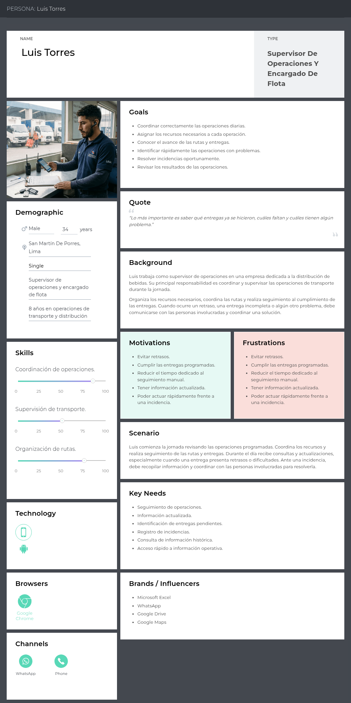

Ver en UXPressia: https://uxpressia.com/w/v8FzI/p/ZvlM6

#### User Persona del Segmento Objetivo 3: Bodegas y minimarkets

María Fernández, de 39 años, es propietaria de un minimarket en Los Olivos y trabaja con varios distribuidores. Necesita saber cuándo llegará su pedido y poder comunicar rápidamente un faltante o un producto dañado. Utiliza principalmente el smartphone, y sus canales son WhatsApp, el teléfono e Instagram.

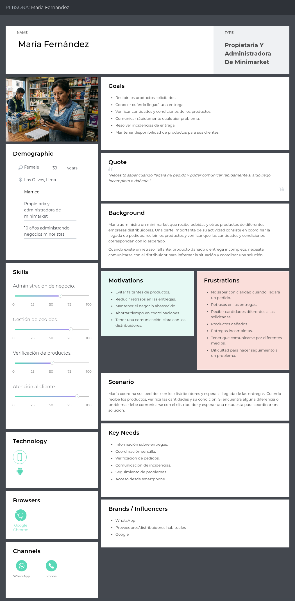

Ver en UXPressia: https://uxpressia.com/w/v8FzI/p/p2gAf

### 2.3.2. User Task Matrix.

El User Task Matrix compara las tareas que realiza cada User Persona según su frecuencia y su importancia. Las tareas marcadas con guion no forman parte de la actividad de esa Persona.

| Tarea | Carlos Mendoza Frecuencia | Carlos Mendoza Importancia | Luis Torres Frecuencia | Luis Torres Importancia | María Fernández Frecuencia | María Fernández Importancia |
| :---- | :-: | :-: | :-: | :-: | :-: | :-: |
| Planificar operaciones de distribución | Alta | Alta | Alta | Alta | - | - |
| Coordinar vehículos | Alta | Alta | Alta | Alta | - | - |
| Coordinar recursos para las entregas | Alta | Alta | Alta | Alta | Media | Media |
| Organizar rutas y puntos de entrega | Alta | Alta | Alta | Alta | - | - |
| Coordinar entregas | Alta | Alta | Alta | Alta | Alta | Alta |
| Consultar el avance de las entregas | Alta | Alta | Alta | Alta | Alta | Alta |
| Verificar la recepción de productos | - | - | Media | Media | Alta | Alta |
| Verificar cantidades recibidas | - | - | Media | Media | Alta | Alta |
| Verificar condición de productos | - | - | Media | Media | Alta | Alta |
| Comunicar retrasos | Alta | Alta | Alta | Alta | Media | Alta |
| Comunicar faltantes o daños | Media | Alta | Alta | Alta | Alta | Alta |
| Resolver problemas de entrega | Media | Alta | Alta | Alta | Media | Alta |
| Registrar información de la operación | Alta | Alta | Alta | Alta | Media | Media |
| Revisar operaciones anteriores | Media | Alta | Media | Alta | Baja | Media |
| Evaluar resultados de la operación | Alta | Alta | Alta | Alta | Baja | Media |

La única tarea con frecuencia e importancia altas para las tres Personas es **consultar el avance de las entregas**, por lo que el seguimiento del estado de cada punto de entrega se ubica en el centro del producto. La verificación de cantidades y condición es crítica solo para la bodega, lo que justifica una vista propia para ese segmento.

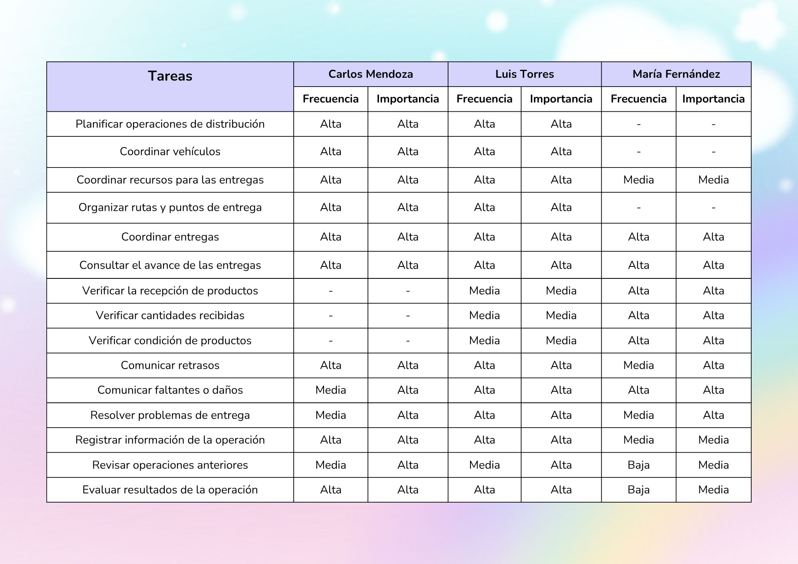

### 2.3.3. User Journey Mapping.

Los User Journey Maps representan el escenario As-Is de cada Persona, es decir, cómo realiza hoy su trabajo sin BottleTrack. Cada mapa recorre las etapas de la jornada e identifica en cada una las acciones, los canales, los pensamientos, las emociones, los puntos de dolor y las oportunidades.

#### User Persona 1: Carlos Mendoza

El recorrido del administrador atraviesa seis etapas: planificar la operación, coordinar recursos, ejecutar entregas, supervisar el avance, resolver incidencias y revisar resultados. Solo la primera y la última se realizan desde la laptop; las cuatro etapas centrales dependen de WhatsApp. La emoción pasa de la incertidumbre a la frustración y la ansiedad mientras espera actualizaciones y atiende incidencias, y recién se recupera al revisar los resultados. Las oportunidades identificadas son mostrar de forma organizada el estado de las operaciones y contar con un historial de operaciones e incidencias.

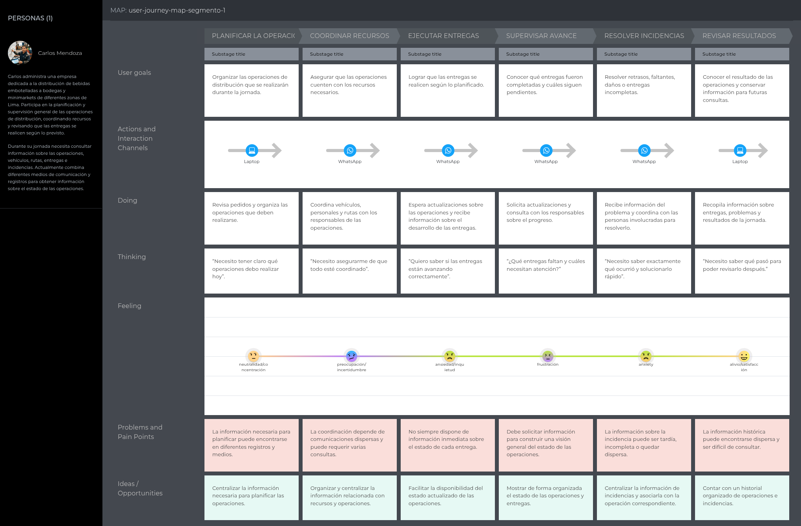

Ver en UXPressia: https://uxpressia.com/w/v8FzI/m/1XPXj

#### User Persona 2: Luis Torres

El recorrido del supervisor atraviesa seis etapas: revisar operaciones, organizar recursos, coordinar rutas, dar seguimiento, atender incidencias y cerrar operaciones. Cuatro de ellas se realizan por WhatsApp. La emoción desciende hasta la frustración y la ansiedad en las etapas de seguimiento y atención de incidencias, porque depende de mensajes que pueden llegar tarde o incompletos. Las oportunidades identificadas son facilitar la consulta del estado de las entregas y registrar las incidencias relacionadas con cada entrega.

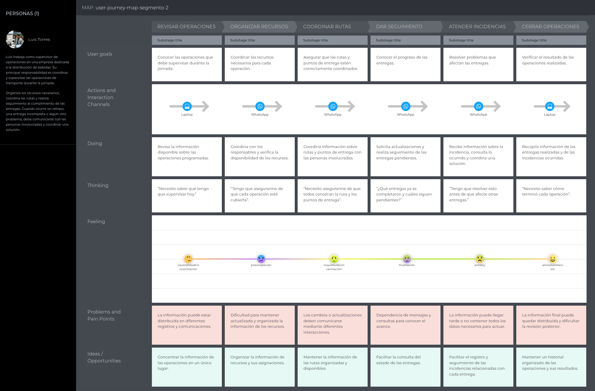

Ver en UXPressia: https://uxpressia.com/w/v8FzI/m/cnzpG

#### User Persona 3: María Fernández

El recorrido de la bodega atraviesa seis etapas: coordinar el pedido, esperar la entrega, recibir los productos, verificar el pedido, comunicar el problema y resolver la incidencia. La verificación se realiza con una lista impresa y la comunicación con el distribuidor, por WhatsApp. Los momentos de mayor tensión son la espera sin información clara sobre el estado de la entrega y la comunicación de un faltante o daño, que no queda registrada de forma organizada. Las oportunidades identificadas son informar el estado de la entrega y facilitar el registro de las diferencias detectadas en la recepción.

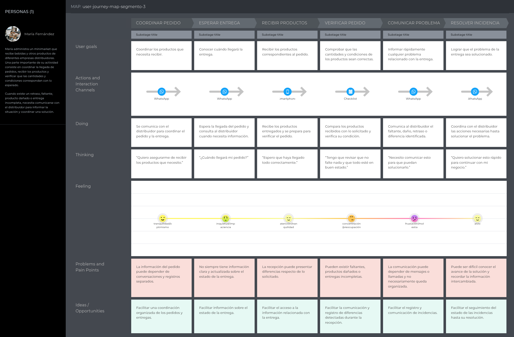

Ver en UXPressia: https://uxpressia.com/w/v8FzI/m/XFb9u

### 2.3.4. Empathy Mapping.

Los Empathy Maps organizan lo que cada Persona dice, piensa, hace, ve, escucha y siente, junto con sus pains y gains. Permiten al equipo contrastar las tres perspectivas sobre un mismo proceso de distribución.

#### User Persona 1: Carlos Mendoza

Su pain principal es no poder evaluar el desempeño de la operación sin pedir reportes, y su gain es la información centralizada y confiable para decidir.

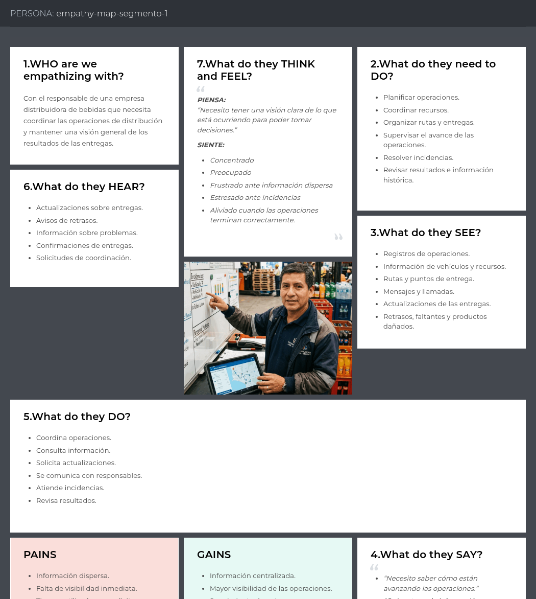

Ver en UXPressia: https://uxpressia.com/w/v8FzI/p/ByEH9

#### User Persona 2: Luis Torres

Su pain principal es la dependencia de los mensajes de los conductores, y su gain es saber en todo momento qué entregas se completaron, cuáles faltan y cuáles presentan un problema.

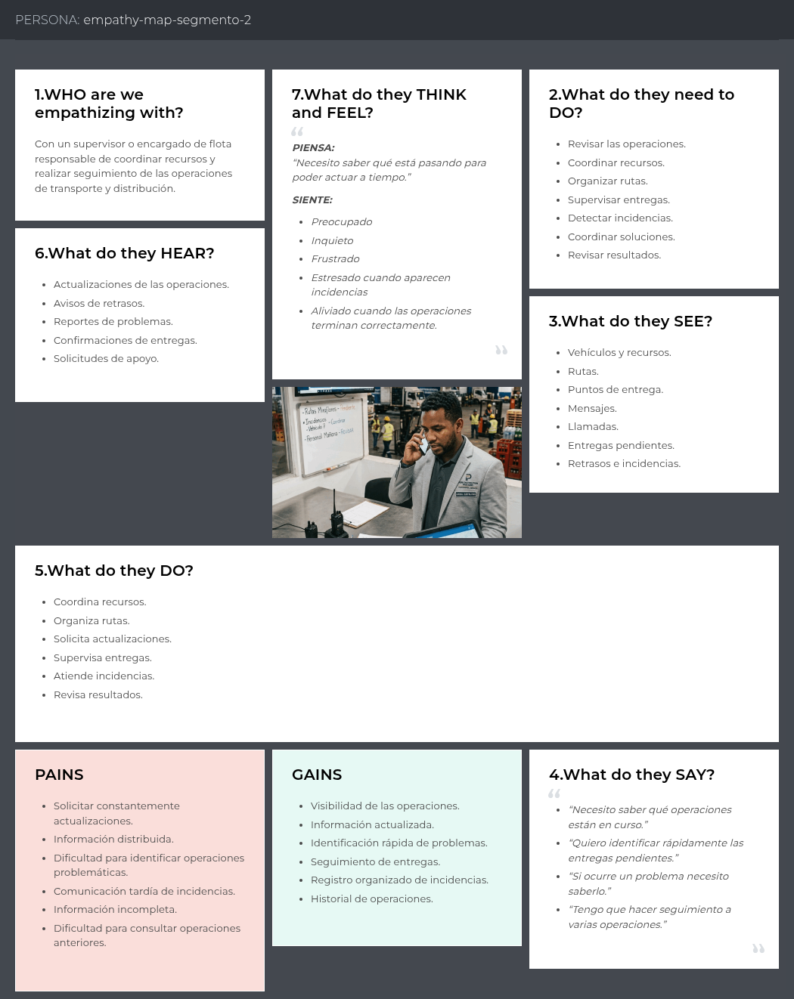

Ver en UXPressia: https://uxpressia.com/w/v8FzI/p/kjfDJ

#### User Persona 3: María Fernández

Su pain principal es la incertidumbre sobre la llegada del pedido y la falta de constancia de los problemas, y su gain es recibir lo solicitado y comunicar una incidencia de forma rápida.

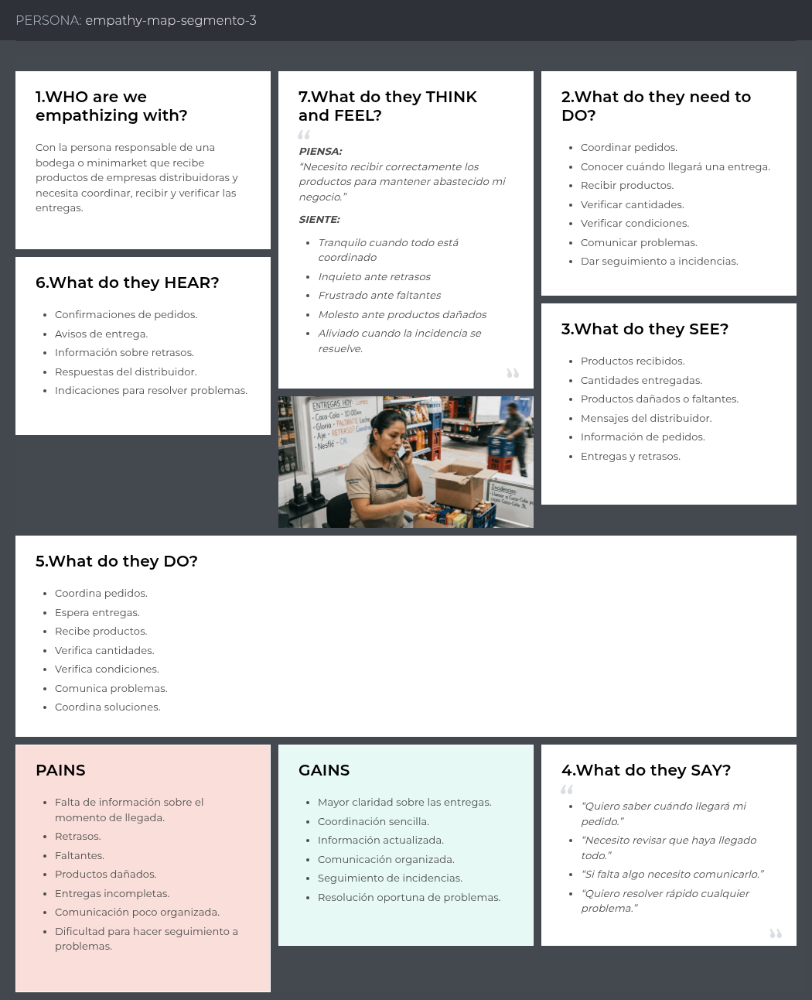

Ver en UXPressia: https://uxpressia.com/w/v8FzI/p/97hC8

## 2.4. Big Picture EventStorming.

En esta sección el equipo introduce y resume el proceso realizado durante la sesión de Big Picture EventStorming, cuyo propósito fue comprender el dominio del transporte de bebidas embotelladas en general, plasmando los eventos significativos del negocio y sus relaciones antes de considerar cualquier decisión de software.

El tablero se elaboró en Miro y se encuentra disponible en el siguiente enlace: https://miro.com/welcomeonboard/aEpQNnI1bURVdldqRzNDWk5aUnR6bStSQnhiSmpuYi9RM01sVkxtOWNsM3V5T1NkRW5pdHFuZ003VHcrV0hxR29tQ0xvRTJHV1VNTzNYUWV1VmwyWUZGRzlld2tuSnZKRTNrM3RnczNnc0NMQWt2WlB6WnEzRXBES1h0d2svaStnbHpza3F6REdEcmNpNEFOMmJXWXBBPT0hdjE=?share_link_id=491275847129

**Desarrollo de la sesión**

La sesión se organizó recorriendo la línea temporal del negocio de izquierda a derecha, y agrupó **43 eventos de dominio** en seis fases consecutivas:

| Fase | Alcance |
| :--- | :------ |
| 1. Preparación de recursos | Incorporación de la empresa distribuidora, sus usuarios, los vehículos, los conductores y los puntos de entrega. |
| 2. Despacho de la operación | Creación de la operación de transporte, asignación de vehículo y conductor, y autorización de salida. |
| 3. Tránsito y monitoreo IoT | Inicio del recorrido y recepción de las lecturas de ubicación, temperatura e impactos enviadas por los dispositivos. |
| 4. Ejecución de la entrega | Llegada a cada punto de entrega y registro de su resultado, incluyendo entregas parciales, no realizadas y faltantes. |
| 5. Reporte de incidencias | Registro del problema por parte del conductor, adjunto de evidencia, revisión y resolución por parte del supervisor. |
| 6. Cierre y análisis | Finalización de la operación, cálculo de la merma y actualización de los indicadores de la distribuidora. |

**Pivotal events.** El equipo identificó tres eventos pivote, es decir, aquellos que marcan un cambio de responsabilidad en el proceso y separan una fase de la siguiente. En el tablero se representan como bandas verticales que atraviesan la línea temporal.

| Pivotal event | Transición que marca |
| :------------ | :------------------- |
| **Operation Dispatched** | La operación deja de ser una planificación y pasa a ser una ejecución en curso. La responsabilidad se traslada del supervisor al conductor. |
| **Delivery Point Reached** | El seguimiento del recorrido da paso a la atención del cliente en el punto de entrega. |
| **Operation Completed** | La ejecución concluye y comienza el análisis de los resultados, que es la etapa que alimenta los indicadores del negocio. |

Junto con los eventos, el equipo identificó los actores que participan en el proceso, los sistemas externos con los que la solución interactúa y los hot spots del dominio.

**Actores identificados:** Fleet Supervisor, Driver, Distribution Manager y el propio IoT Device, que actúa como emisor de eventos sin intervención humana.

**Sistemas externos identificados:** el servicio de mapas y geolocalización, y el proveedor de los dispositivos IoT instalados en los vehículos.

**Hot spots.** Los hot spots corresponden a las preguntas del dominio que el equipo no puede responder por sí mismo y que debe resolver con los interesados durante las entrevistas:

| Hot spot | Por qué importa |
| :------- | :-------------- |
| ¿Qué ocurre si el dispositivo IoT pierde conexión durante la ruta? | Determina si el seguimiento debe tolerar vacíos de información y cómo se comunican al supervisor. |
| ¿Quién valida un faltante, el conductor o el cliente que recibe? | Define sobre quién recae la responsabilidad del registro y qué evidencia resulta suficiente. |
| ¿Se puede reasignar una operación que ya fue iniciada? | Condiciona el ciclo de vida de la operación y las reglas de asignación de recursos. |
| ¿Cuánto tiempo debe conservarse la evidencia de una incidencia? | Afecta las decisiones de almacenamiento y las obligaciones frente al cliente. |

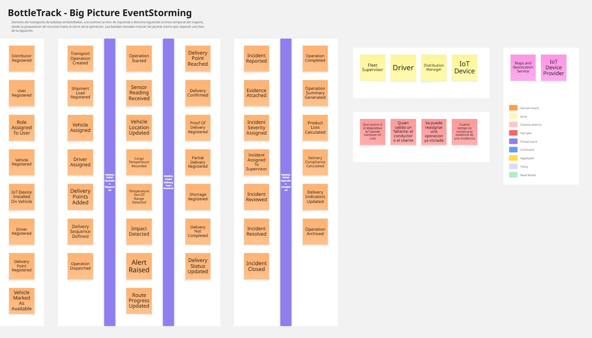

Los eventos identificados en esta sesión constituyen la base sobre la que se profundiza en el Design-Level EventStorming de la sección 4.6.1, donde se incorporan los comandos, las políticas y los agregados que dan lugar a los bounded contexts.

## 2.5. Ubiquitous Language.

El Ubiquitous Language es el glosario de términos y conceptos del dominio del negocio que todos los miembros del equipo y los interesados emplean sin ambigüedad. Los términos que se presentan a continuación corresponden al dominio de la distribución y el transporte de bebidas embotelladas, y no a conceptos técnicos de la ingeniería de software. Cada término se define en inglés, que es el idioma adoptado para la nomenclatura del código y para la interfaz por defecto de los productos, acompañado de su equivalente en español entre paréntesis.

Este glosario es la fuente de la que se derivan los nombres de las entidades del modelo, los endpoints de la API y las etiquetas de la interfaz descritas en el Labeling System, de manera que un mismo concepto se nombre igual en la conversación con el cliente, en el informe, en la interfaz y en el código.

**Términos del proceso de distribución**

| Término | Definición |
| :------ | :--------- |
| **Bottling Plant** (Planta embotelladora) | Instalación donde el producto es envasado y desde la cual se despacha hacia los puntos de entrega. Constituye el origen de la operación de transporte. |
| **Distributor** (Distribuidora) | Empresa responsable de trasladar el producto embotellado desde la planta hasta los puntos de venta. Es la organización que contrata la plataforma. |
| **Fleet** (Flota) | Conjunto de vehículos con los que la distribuidora ejecuta sus operaciones de reparto. |
| **Vehicle** (Vehículo) | Unidad de transporte identificada por su placa, a la que se asigna una ruta y sobre la cual pueden encontrarse instalados dispositivos de monitoreo. |
| **Driver** (Conductor) | Persona responsable de conducir el vehículo, ejecutar las entregas de una ruta y reportar las incidencias que ocurran durante el trayecto. |
| **Supervisor** (Supervisor) | Persona responsable de planificar y controlar las rutas de la flota, atender las alertas y dar seguimiento a las incidencias hasta su cierre. |
| **Delivery Point** (Punto de entrega) | Establecimiento que recibe el producto, como una bodega, un minimarket o un cliente mayorista. |

**Términos de la operación de transporte**

| Término | Definición |
| :------ | :--------- |
| **Shipment** (Envío) | Carga de producto embotellado que se despacha desde la planta con destino a uno o varios puntos de entrega. Es la unidad sobre la que se realiza el seguimiento. |
| **Route** (Ruta) | Recorrido planificado que un vehículo debe cubrir para completar un envío, conformado por una secuencia ordenada de paradas. |
| **Stop** (Parada) | Cada punto de entrega individual dentro de una ruta, con su estado propio de cumplimiento. |
| **Dispatch** (Despacho) | Acto de registrar un envío, asignarle un vehículo y un conductor, y autorizar su salida de la planta. |
| **Route Progress** (Avance de la ruta) | Proporción de paradas completadas respecto del total de paradas planificadas para una ruta. |
| **Proof of Delivery** (Constancia de entrega) | Registro que confirma que el producto fue recibido en una parada, incluyendo la cantidad efectivamente entregada. |
| **Shortage** (Faltante) | Diferencia negativa entre la cantidad de producto despachada y la cantidad recibida en el punto de entrega. |
| **Product Loss** (Merma) | Cantidad de producto que no llega en condiciones de ser vendido, ya sea por rotura, daño o faltante. |

**Términos del monitoreo con dispositivos IoT**

| Término | Definición |
| :------ | :--------- |
| **IoT Device** (Dispositivo IoT) | Equipo instalado en el vehículo o en la carga que registra y transmite información del transporte hacia la plataforma. |
| **Sensor** (Sensor) | Componente del dispositivo que mide una magnitud específica del transporte, como la posición, la temperatura o la aceleración. |
| **Sensor Reading** (Lectura de sensor) | Valor registrado por un sensor en un instante determinado, asociado a un envío y a una posición del recorrido. |
| **Cargo Temperature** (Temperatura de la carga) | Temperatura registrada en el compartimento donde viaja el producto embotellado. |
| **Safe Range** (Rango seguro) | Intervalo de valores dentro del cual una magnitud monitoreada se considera aceptable para preservar la calidad del producto. |
| **Impact** (Golpe) | Movimiento brusco detectado por los sensores, que representa un riesgo de rotura para el producto embotellado. |
| **Alert** (Alerta) | Aviso generado automáticamente cuando una lectura de sensor se sitúa fuera del rango seguro o cuando se detecta un golpe. |
| **Telemetry** (Telemetría) | Conjunto de lecturas transmitidas por los dispositivos durante el trayecto, que sustenta el seguimiento del envío. |

**Términos del reporte de incidencias**

| Término | Definición |
| :------ | :--------- |
| **Incident** (Incidencia) | Problema ocurrido durante el transporte que afecta la entrega, reportado por el conductor o generado a partir de una alerta. |
| **Incident Type** (Tipo de incidencia) | Clasificación de la incidencia según su naturaleza: producto dañado, botellas rotas, unidades faltantes o retraso. |
| **Broken Bottle** (Botella rota) | Unidad de producto que llega quebrada y no puede ser entregada al punto de venta. |
| **Damaged Product** (Producto dañado) | Unidad que, sin estar rota, presenta un deterioro que impide su comercialización. |
| **Delay** (Retraso) | Diferencia entre el momento planificado y el momento real de llegada a una parada. |
| **Evidence** (Evidencia) | Registro fotográfico y descriptivo que el conductor adjunta a una incidencia para sustentar lo ocurrido. |
| **Severity** (Severidad) | Grado de afectación de una incidencia sobre la operación, empleado por el supervisor para priorizar su atención. |
| **Incident Follow-up** (Seguimiento de incidencia) | Proceso mediante el cual el supervisor revisa una incidencia reportada, registra las acciones tomadas y determina su cierre. |
| **Resolution** (Resolución) | Cierre de una incidencia por parte del supervisor, con la conclusión de lo ocurrido y la acción adoptada. |

---

[← Capítulo I](10-chapter-1-introduction.md) · [Contenido](../README.md#contenido) · [Capítulo III →](30-chapter-3-requirements-specification.md)