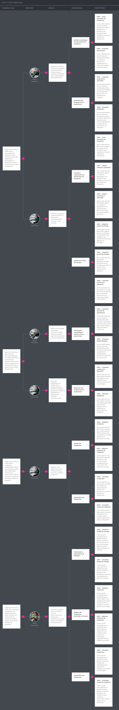

[← Capítulo II](20-chapter-2-requirements-elicitation-and-analysis.md) · [Contenido](../README.md#contenido) · [Capítulo IV →](40-chapter-4-product-design.md)

# Capítulo III: Requirements Specification

En este capítulo se presenta la especificación preliminar de los requisitos de BottleTrack, tomando como base el dominio del problema, las assumptions definidas durante el proceso Lean UX y las necesidades inicialmente identificadas para los segmentos objetivo.

BottleTrack estará compuesto principalmente por una **Web Application responsive**, un **RESTful API de desarrollo propio** y un **Landing Page** encargado de presentar la propuesta de valor de CodeCrafters.

La Web Application estará orientada principalmente a tres tipos de usuario:

- Administradores de las empresas distribuidoras.
- Supervisores o encargados de flota.
- Responsables de bodegas y minimarkets, que acceden a una vista de seguimiento de sus pedidos.

Los requisitos funcionales serán representados mediante Epics y User Stories. Asimismo, se incluirán Technical Stories relacionadas con los servicios requeridos por el RESTful API y las integraciones externas de BottleTrack.

## 3.1. User Stories.

### Epics

Las Epics de BottleTrack agrupan las principales capacidades del producto y permiten organizar las User Stories y Technical Stories de acuerdo con el dominio al que pertenecen.

| ID | Título | Descripción |
| --- | --- | --- |
| **EP01** | Landing Page | Presentación de BottleTrack, su propuesta de valor, segmentos objetivo y principales beneficios. |
| **EP02** | Identity and Access Management | Gestión de autenticación, sesiones, usuarios, roles y permisos de acceso a BottleTrack. |
| **EP03** | Company Management | Gestión de la información de la empresa distribuidora y de los usuarios que forman parte de ella. |
| **EP04** | Fleet Management | Gestión de vehículos y conductores utilizados durante las operaciones de transporte. |
| **EP05** | Transport Operations Management | Creación, asignación, inicio, seguimiento y finalización de las operaciones de transporte. |
| **EP06** | Delivery Management | Gestión de puntos de entrega, rutas y estados de las entregas realizadas durante una operación. |
| **EP07** | Incident Management | Registro, evidencia, consulta y seguimiento de incidencias ocurridas durante las operaciones de transporte. |
| **EP08** | Monitoring and Analytics | Seguimiento del progreso de las operaciones, dashboard, indicadores e historial de operaciones. |
| **EP09** | External Services Integration | Integración de BottleTrack con servicios externos de mapas y geolocalización para complementar las operaciones de transporte. |
| **EP10** | IoT Cargo Monitoring | Recepción de lecturas de los dispositivos IoT, configuración de rangos seguros y generación de alertas sobre la carga. |
| **EP11** | Delivery Point Tracking | Consulta del estado del pedido y reporte de problemas de recepción por parte de las bodegas y minimarkets. |

### User Stories

| ID | Título | Descripción | Criterios de Aceptación | Relacionado con (Epic ID) |
| --- | --- | --- | --- | --- |
| **US01** | Conocer BottleTrack | Como visitante, deseo conocer qué es BottleTrack para determinar si la solución responde a mis necesidades. | **Escenario 1:** Given que el visitante accede al Landing Page, when consulta la sección principal, then obtiene el nombre del producto, su propuesta de valor y el problema que resuelve.  **Escenario 2:** Given que el visitante tiene configurado el navegador en español, when accede al sitio, then el contenido se presenta en español latinoamericano. | EP01 |
| **US02** | Conocer beneficios por segmento | Como visitante perteneciente a un segmento objetivo, deseo conocer los beneficios relacionados con mi perfil para comprender cómo BottleTrack podría ayudarme. | **Escenario 1:** Given que el visitante consulta las capacidades del producto, when revisa la información de BottleTrack, then obtiene la descripción del seguimiento de entregas, el registro de incidencias y el monitoreo IoT. | EP01 |
| **US03** | Acceder a la aplicación | Como visitante interesado en BottleTrack, deseo acceder a la aplicación web para continuar mi experiencia con el producto. | **Escenario 1:** Given que el visitante pertenece a un segmento objetivo, when realiza la acción de acceso de su segmento, then es dirigido a la vista de la Web Application que corresponde a ese segmento. | EP01 |
| **US04** | Iniciar sesión | Como usuario registrado, deseo autenticarme en BottleTrack para acceder a las funcionalidades correspondientes a mi rol. | **Escenario 1:** Given que el usuario proporciona credenciales válidas, when solicita autenticarse, then el sistema autoriza su acceso.  **Escenario 2:** Given que las credenciales son inválidas, when se solicita la autenticación, then el sistema rechaza el acceso. | EP02 |
| **US05** | Cerrar sesión | Como usuario autenticado, deseo finalizar mi sesión para evitar accesos posteriores desde la sesión activa. | **Escenario 1:** Given que existe una sesión activa, when el usuario solicita finalizarla, then el sistema invalida la sesión correspondiente. | EP02 |
| **US06** | Consultar perfil | Como usuario autenticado, deseo consultar la información de mi perfil para conocer los datos asociados con mi cuenta. | **Escenario 1:** Given que el usuario se encuentra autenticado, when consulta su perfil, then el sistema proporciona la información registrada para su cuenta. | EP02 |
| **US07** | Gestionar usuarios | Como administrador, deseo registrar y actualizar usuarios para controlar quiénes pueden utilizar BottleTrack dentro de la empresa. | **Escenario 1:** Given que se proporcionan datos válidos, when el administrador registra un usuario, then el usuario queda asociado con la empresa.  **Escenario 2:** Given que existe un usuario registrado, when el administrador actualiza sus datos, then el sistema conserva la nueva información. | EP03 |
| **US08** | Asignar rol a usuario | Como administrador, deseo asignar roles a los usuarios para determinar las funcionalidades a las que pueden acceder. | **Escenario 1:** Given que existe un usuario registrado, when el administrador asigna un rol válido, then el sistema conserva la relación entre el usuario y el rol. | EP03 |
| **US09** | Gestionar información de empresa | Como administrador, deseo mantener actualizada la información de la empresa para que BottleTrack utilice correctamente sus datos. | **Escenario 1:** Given que la empresa se encuentra registrada, when el administrador actualiza información válida, then el sistema conserva los cambios. | EP03 |
| **US10** | Registrar vehículo | Como administrador o supervisor, deseo registrar un vehículo para incorporarlo a los recursos disponibles para las operaciones. | **Escenario 1:** Given que se proporcionan datos válidos del vehículo, when se solicita su registro, then el vehículo queda almacenado.  **Escenario 2:** Given que faltan datos obligatorios, when se intenta registrar el vehículo, then el sistema rechaza el registro. | EP04 |
| **US11** | Actualizar vehículo | Como administrador o supervisor, deseo actualizar la información de un vehículo para mantener los datos de la flota vigentes. | **Escenario 1:** Given que existe un vehículo registrado, when se proporcionan datos válidos para actualizarlo, then el sistema conserva la nueva información. | EP04 |
| **US12** | Consultar vehículos disponibles | Como supervisor de flota, deseo conocer los vehículos disponibles para determinar cuáles pueden ser asignados a una operación. | **Escenario 1:** Given que existen vehículos con estado disponible y en mantenimiento, when el supervisor consulta los vehículos disponibles, then el sistema proporciona solo los vehículos con estado disponible.  **Escenario 2:** Given que todos los vehículos están asignados, when el supervisor consulta los disponibles, then el sistema informa que no hay vehículos disponibles. | EP04 |
| **US13** | Registrar conductor | Como administrador o supervisor, deseo registrar un conductor para incorporarlo al personal disponible para las operaciones. | **Escenario 1:** Given que se proporcionan datos válidos del conductor, when se solicita su registro, then el conductor queda almacenado.  **Escenario 2:** Given que falta información requerida, when se intenta realizar el registro, then el sistema rechaza la operación. | EP04 |
| **US14** | Actualizar conductor | Como administrador o supervisor, deseo actualizar la información de un conductor para mantener sus datos vigentes. | **Escenario 1:** Given que existe un conductor registrado, when se proporcionan datos válidos para actualizarlo, then el sistema conserva la nueva información. | EP04 |
| **US15** | Consultar conductores disponibles | Como supervisor de flota, deseo conocer los conductores disponibles para determinar quién puede ser asignado a una operación. | **Escenario 1:** Given que existen conductores con estado activo y sin operación en curso, when el supervisor consulta la disponibilidad, then el sistema proporciona solo esos conductores.  **Escenario 2:** Given que un conductor tiene una operación en curso, when se consulta la disponibilidad, then el conductor no forma parte del resultado. | EP04 |
| **US16** | Crear operación de transporte | Como supervisor de flota, deseo registrar una operación de transporte para organizar una nueva jornada de distribución. | **Escenario 1:** Given que se proporcionan los datos requeridos, when el supervisor registra la operación, then el sistema crea la operación con estado pendiente.  **Escenario 2:** Given que falta información obligatoria, when se intenta registrar la operación, then el sistema rechaza la solicitud. | EP05 |
| **US17** | Asignar vehículo a operación | Como supervisor de flota, deseo asignar un vehículo disponible a una operación para establecer el recurso que realizará el transporte. | **Escenario 1:** Given que existe un vehículo disponible, when el supervisor realiza la asignación, then el vehículo queda asociado con la operación.  **Escenario 2:** Given que el vehículo no se encuentra disponible, when se intenta realizar la asignación, then el sistema rechaza la solicitud. | EP05 |
| **US18** | Asignar conductor a operación | Como supervisor de flota, deseo asignar un conductor disponible a una operación para determinar quién será responsable de ejecutarla. | **Escenario 1:** Given que existe un conductor disponible, when el supervisor realiza la asignación, then el conductor queda asociado con la operación.  **Escenario 2:** Given que el conductor no se encuentra disponible, when se intenta realizar la asignación, then el sistema rechaza la solicitud. | EP05 |
| **US19** | Consultar operaciones | Como supervisor de flota, deseo consultar las operaciones registradas para conocer su estado y principales datos. | **Escenario 1:** Given que existen operaciones registradas, when el supervisor filtra por estado en curso, then el sistema proporciona solo las operaciones en curso con su vehículo, conductor y avance. | EP05 |
| **US20** | Cancelar operación | Como supervisor de flota, deseo cancelar una operación que aún no ha iniciado para liberar el vehículo y el conductor asignados. | **Escenario 1:** Given que existe una operación pendiente con recursos asignados, when el supervisor la cancela indicando el motivo, then la operación cambia a estado cancelada y el vehículo y el conductor quedan disponibles.  **Escenario 2:** Given que la operación ya fue iniciada, when el supervisor intenta cancelarla, then el sistema rechaza la solicitud. | EP05 |
| **US21** | Iniciar operación | Como supervisor de flota, deseo iniciar una operación de transporte para registrar que la ejecución de la ruta ha comenzado. | **Escenario 1:** Given que existe una operación pendiente, when el supervisor registra el inicio, then la operación cambia a estado en curso. | EP05 |
| **US22** | Finalizar operación | Como supervisor de flota, deseo finalizar una operación cuando las actividades correspondientes hayan concluido para dejar constancia de su cierre. | **Escenario 1:** Given que una operación está en curso y todas sus entregas tienen un resultado registrado, when el supervisor solicita finalizarla, then la operación cambia a estado completada.  **Escenario 2:** Given que una operación tiene entregas pendientes, when el supervisor solicita finalizarla, then el sistema rechaza la solicitud e indica las entregas pendientes. | EP05 |
| **US23** | Registrar punto de entrega | Como supervisor de flota, deseo agregar puntos de entrega a una operación para establecer los establecimientos que deberán ser atendidos. | **Escenario 1:** Given que existe una operación, when se registra información válida de un punto de entrega, then el punto queda asociado con la operación.  **Escenario 2:** Given que faltan datos obligatorios, when se intenta registrar el punto, then el sistema rechaza la solicitud. | EP06 |
| **US24** | Organizar puntos de entrega | Como supervisor de flota, deseo establecer el orden de los puntos de entrega para definir la secuencia de atención de la operación. | **Escenario 1:** Given que existen varios puntos de entrega asociados con una operación, when el supervisor define su secuencia, then el sistema conserva el orden establecido. | EP06 |
| **US25** | Consultar ruta de una operación | Como supervisor de flota, deseo consultar los puntos de entrega de una operación para conocer los lugares que deben ser atendidos. | **Escenario 1:** Given que existe una operación registrada, when el supervisor consulta sus puntos de entrega, then el sistema proporciona los puntos asociados y su estado. | EP06 |
| **US26** | Consultar detalle de entrega | Como supervisor de flota, deseo consultar información de un punto de entrega para conocer los datos necesarios antes de dar seguimiento a su atención. | **Escenario 1:** Given que existe un punto de entrega registrado, when el supervisor solicita su información, then el sistema proporciona el nombre del establecimiento, la dirección, el contacto, la cantidad de producto programada y el estado de la entrega. | EP06 |
| **US27** | Actualizar estado de entrega | Como supervisor de flota, deseo actualizar el estado de una entrega para registrar el resultado de la visita reportado por el conductor. | **Escenario 1:** Given que existe una entrega pendiente, when el supervisor registra un estado permitido, then el sistema conserva el nuevo estado. | EP06 |
| **US28** | Registrar entrega parcial | Como supervisor de flota, deseo registrar una entrega parcial para dejar constancia de que solo una parte de los productos pudo ser entregada. | **Escenario 1:** Given que una entrega no puede completarse totalmente, when el supervisor registra el resultado y el motivo correspondiente, then la entrega queda identificada como parcial. | EP06 |
| **US29** | Registrar entrega no realizada | Como supervisor de flota, deseo registrar que una entrega no pudo realizarse para dejar constancia del resultado de la visita. | **Escenario 1:** Given que una entrega no puede efectuarse, when el supervisor registra el motivo correspondiente, then el sistema conserva la entrega como no realizada. | EP06 |
| **US30** | Registrar incidencia | Como supervisor de flota, deseo registrar una incidencia para dejar constancia de un problema ocurrido durante una operación o entrega. | **Escenario 1:** Given que ocurre un problema durante la operación, when el supervisor proporciona la información requerida, then la incidencia queda registrada y relacionada con la operación.  **Escenario 2:** Given que faltan datos requeridos, when se intenta registrar la incidencia, then el sistema rechaza la solicitud. | EP07 |
| **US31** | Adjuntar evidencia de incidencia | Como supervisor de flota, deseo adjuntar evidencia a una incidencia para complementar la información del problema ocurrido. | **Escenario 1:** Given que existe una incidencia registrada, when se proporciona evidencia válida, then la evidencia queda asociada con la incidencia. | EP07 |
| **US32** | Consultar incidencias | Como supervisor de flota, deseo consultar las incidencias registradas para conocer los problemas ocurridos durante las operaciones. | **Escenario 1:** Given que existen incidencias registradas, when el supervisor realiza la consulta, then el sistema proporciona los registros correspondientes. | EP07 |
| **US33** | Actualizar estado de incidencia | Como supervisor de flota, deseo actualizar el estado de una incidencia para realizar seguimiento hasta su resolución. | **Escenario 1:** Given que existe una incidencia pendiente, when el supervisor registra un nuevo estado válido, then el sistema conserva la modificación. | EP07 |
| **US34** | Consultar progreso de operación | Como supervisor de flota, deseo consultar el progreso de una operación para conocer el estado de sus entregas. | **Escenario 1:** Given que existe una operación en curso, when el supervisor consulta su progreso, then obtiene las entregas completadas, pendientes, parciales y no realizadas. | EP08 |
| **US35** | Consultar dashboard | Como administrador o supervisor, deseo consultar indicadores generales para conocer rápidamente el estado de las operaciones de transporte. | **Escenario 1:** Given que existen operaciones registradas en el mes, when el usuario consulta los indicadores, then el sistema proporciona el total de operaciones, el porcentaje de entregas completadas, la cantidad de incidencias abiertas y la merma acumulada.  **Escenario 2:** Given que no existen operaciones registradas, when el usuario consulta los indicadores, then el sistema proporciona los indicadores con valor cero. | EP08 |
| **US36** | Consultar historial de operaciones | Como supervisor de flota, deseo consultar operaciones anteriores para revisar información histórica sobre entregas e incidencias. | **Escenario 1:** Given que existen operaciones finalizadas, when el supervisor consulta el historial filtrando por rango de fechas, then el sistema proporciona las operaciones finalizadas en ese rango ordenadas de la más reciente a la más antigua. | EP08 |
| **US37** | Consultar detalle histórico | Como supervisor de flota, deseo consultar el detalle de una operación finalizada para analizar los resultados de su ejecución. | **Escenario 1:** Given que existe una operación finalizada, when el supervisor consulta su detalle, then obtiene información relacionada con vehículo, conductor, entregas e incidencias. | EP08 |
| **US38** | Consultar ubicación de entrega | Como supervisor de flota, deseo consultar la ubicación de un punto de entrega para facilitar la identificación del destino. | **Escenario 1:** Given que el punto de entrega contiene una ubicación válida, when se solicita consultar su ubicación, then el sistema obtiene información geográfica asociada al destino. | EP09 |
| **US39** | Conocer beneficios para distribuidoras | Como visitante del segmento de empresas distribuidoras, deseo conocer cómo BottleTrack mejora el control de mis operaciones para evaluar si me conviene contratarlo. | **Escenario 1:** Given que el visitante consulta la información del segmento de distribuidoras, when revisa sus beneficios, then obtiene los beneficios de indicadores, historial y control de la merma.  **Escenario 2:** Given que el visitante decide continuar, when realiza la acción de acceso del segmento, then es dirigido a la vista de indicadores de la Web Application. | EP01 |
| **US40** | Conocer beneficios para supervisores | Como visitante del segmento de supervisores de flota, deseo conocer cómo BottleTrack me ayuda a seguir mis rutas para decidir si lo utilizo en mi jornada. | **Escenario 1:** Given que el visitante consulta la información del segmento de supervisores, when revisa sus beneficios, then obtiene los beneficios de seguimiento de entregas e incidencias.  **Escenario 2:** Given que el visitante decide continuar, when realiza la acción de acceso del segmento, then es dirigido a la vista de operaciones de la Web Application. | EP01 |
| **US41** | Conocer beneficios para bodegas | Como visitante del segmento de bodegas y minimarkets, deseo conocer cómo puedo seguir mis pedidos para reducir la incertidumbre sobre su llegada. | **Escenario 1:** Given que el visitante consulta la información del segmento de bodegas, when revisa sus beneficios, then obtiene los beneficios de seguimiento del pedido y reporte de problemas de recepción.  **Escenario 2:** Given que el visitante decide continuar, when realiza la acción de acceso del segmento, then es dirigido a la vista de seguimiento de pedidos de la Web Application. | EP01 |
| **US42** | Contactar a CodeCrafters | Como visitante interesado, deseo conocer los medios de contacto y las redes sociales de CodeCrafters para solicitar una demostración. | **Escenario 1:** Given que el visitante desea comunicarse con la startup, when consulta la información de contacto, then obtiene el correo, el teléfono y los enlaces a las redes sociales. | EP01 |
| **US43** | Consultar lecturas IoT de una operación | Como supervisor de flota, deseo consultar las lecturas de temperatura, golpes y ubicación de una operación en curso para conocer el estado de la carga. | **Escenario 1:** Given que una operación en curso tiene un dispositivo IoT asociado, when el supervisor consulta sus lecturas, then el sistema proporciona la última lectura de cada sensor con su fecha y hora.  **Escenario 2:** Given que el dispositivo no envía lecturas desde hace más de 10 minutos, when el supervisor consulta la operación, then el sistema indica que el dispositivo está sin conexión. | EP10 |
| **US44** | Recibir alerta de carga en riesgo | Como supervisor de flota, deseo recibir una alerta cuando una lectura salga del rango seguro o se detecte un golpe para actuar antes de que el producto se dañe. | **Escenario 1:** Given que el rango seguro de temperatura es de 2 °C a 25 °C, when se registra una lectura de 28 °C, then el sistema genera una alerta asociada a la operación.  **Escenario 2:** Given que se genera una alerta, when el supervisor la revisa, then puede registrar una incidencia a partir de ella. | EP10 |
| **US45** | Configurar rango seguro | Como administrador, deseo configurar el rango seguro de temperatura y el umbral de golpes para adaptar las alertas al tipo de bebida transportada. | **Escenario 1:** Given que se proporcionan un mínimo y un máximo válidos, when el administrador guarda el rango, then las nuevas lecturas se evalúan con ese rango.  **Escenario 2:** Given que el mínimo es mayor que el máximo, when se intenta guardar el rango, then el sistema rechaza la solicitud. | EP10 |
| **US46** | Consultar estado de mi pedido | Como responsable de una bodega, deseo consultar el estado de mi pedido para saber cuándo llegará. | **Escenario 1:** Given que la bodega es un punto de entrega de una operación en curso, when su responsable consulta el pedido, then el sistema proporciona el estado de la entrega y la cantidad de paradas previas.  **Escenario 2:** Given que la entrega fue completada, when se consulta el pedido, then el sistema proporciona la cantidad entregada y la fecha de entrega. | EP11 |
| **US47** | Reportar problema de recepción | Como responsable de una bodega, deseo reportar un faltante o un producto dañado al recibir mi pedido para que quede constancia y la distribuidora lo atienda. | **Escenario 1:** Given que la entrega fue registrada, when el responsable reporta un faltante indicando la cantidad, then se genera una incidencia asociada a la entrega y visible para el supervisor.  **Escenario 2:** Given que no se indica el tipo de problema, when se intenta enviar el reporte, then el sistema rechaza la solicitud. | EP11 |

### Technical Stories

Las Technical Stories representan los requisitos técnicos necesarios para implementar el Backend RESTful API de BottleTrack, así como las integraciones necesarias para soportar las funcionalidades de la Web Application.

| ID | Título | Descripción | Criterios de Aceptación | Relacionado con (Epic ID) |
| --- | --- | --- | --- | --- |
| **TS01** | Authentication REST API | Como Developer, deseo disponer de servicios RESTful de autenticación para permitir que los usuarios autorizados accedan a BottleTrack. | **Escenario 1:** Given que el servicio recibe credenciales válidas, when procesa la solicitud de autenticación, then devuelve una respuesta exitosa con la información necesaria para autorizar al usuario.  **Escenario 2:** Given que el servicio recibe credenciales inválidas, when procesa la solicitud, then devuelve una respuesta de autenticación fallida.  **Escenario 3:** Given que un usuario no se encuentra autorizado, when intenta acceder a un recurso protegido, then el servicio rechaza la solicitud. | EP02 |
| **TS02** | User and Company REST API | Como Developer, deseo disponer de servicios RESTful para administrar usuarios, roles y empresas para soportar las funcionalidades administrativas de BottleTrack. | **Escenario 1:** Given que se recibe información válida de un usuario, when se solicita su registro, then el servicio crea el recurso y devuelve una respuesta exitosa.  **Escenario 2:** Given que existe un usuario registrado, when se solicita actualizar información válida, then el servicio conserva los cambios.  **Escenario 3:** Given que se recibe información inválida, when el servicio procesa la solicitud, then devuelve el código de error correspondiente. | EP03 |
| **TS03** | Vehicle Management REST API | Como Developer, deseo disponer de servicios RESTful para administrar vehículos para permitir que el Frontend gestione los recursos de la flota. | **Escenario 1:** Given que se proporciona información válida de un vehículo, when se solicita su registro, then el servicio almacena el recurso y devuelve una respuesta exitosa.  **Escenario 2:** Given que existe un vehículo registrado, when se solicita su actualización con información válida, then el servicio conserva los cambios.  **Escenario 3:** Given que se solicitan los vehículos disponibles, when el servicio procesa la consulta, then devuelve los vehículos cuyo estado permite su asignación. | EP04 |
| **TS04** | Driver Management REST API | Como Developer, deseo disponer de servicios RESTful para administrar conductores para soportar la gestión del personal encargado de las operaciones. | **Escenario 1:** Given que se proporciona información válida de un conductor, when se solicita su registro, then el servicio almacena el recurso.  **Escenario 2:** Given que existe un conductor registrado, when se solicita actualizar sus datos, then el servicio conserva la información modificada.  **Escenario 3:** Given que se solicitan conductores disponibles, when el servicio procesa la consulta, then devuelve aquellos que pueden ser asignados a una operación. | EP04 |
| **TS05** | Transport Operations REST API | Como Developer, deseo disponer de servicios RESTful para crear, consultar y actualizar operaciones de transporte para soportar el proceso principal de BottleTrack. | **Escenario 1:** Given que se recibe información válida de una operación, when se solicita su creación, then el servicio almacena la operación y devuelve el recurso creado.  **Escenario 2:** Given que existe una operación registrada, when se solicita su información, then el servicio devuelve los datos correspondientes.  **Escenario 3:** Given que una operación cumple las condiciones para cambiar de estado, when se solicita la actualización, then el servicio conserva el nuevo estado. | EP05 |
| **TS06** | Resource Assignment Service | Como Developer, deseo implementar servicios para asignar vehículos y conductores a operaciones para garantizar que los recursos utilizados se encuentren disponibles. | **Escenario 1:** Given que el vehículo y conductor se encuentran disponibles, when se solicita su asignación, then el servicio registra la relación con la operación.  **Escenario 2:** Given que un vehículo ya está asignado a una operación incompatible, when se intenta asignarlo nuevamente, then el servicio rechaza la solicitud.  **Escenario 3:** Given que un conductor no se encuentra disponible, when se intenta asignarlo, then el servicio rechaza la operación. | EP05 |
| **TS07** | Delivery Management REST API | Como Developer, deseo disponer de servicios RESTful para administrar puntos de entrega y sus estados para soportar la ejecución y seguimiento de las rutas. | **Escenario 1:** Given que existe una operación válida, when se registra un punto de entrega con información correcta, then queda asociado con la operación.  **Escenario 2:** Given que existen varios puntos de entrega, when se actualiza su secuencia, then el servicio conserva el nuevo orden.  **Escenario 3:** Given que existe una entrega pendiente, when se recibe una actualización de estado válida, then el servicio conserva el nuevo estado. | EP06 |
| **TS08** | Incident Management REST API | Como Developer, deseo disponer de servicios RESTful para registrar, consultar y actualizar incidencias para soportar el seguimiento de problemas ocurridos durante las operaciones. | **Escenario 1:** Given que se recibe información válida de una incidencia, when se solicita su registro, then queda almacenada y asociada con la operación o entrega correspondiente.  **Escenario 2:** Given que existen incidencias registradas, when se solicita su consulta, then el servicio devuelve los registros correspondientes.  **Escenario 3:** Given que existe una incidencia pendiente, when se proporciona un nuevo estado válido, then el servicio conserva la actualización. | EP07 |
| **TS09** | Incident Evidence Service | Como Developer, deseo disponer de un servicio para gestionar evidencias asociadas a incidencias para conservar información complementaria de los problemas reportados. | **Escenario 1:** Given que existe una incidencia válida, when se proporciona una evidencia permitida, then el servicio almacena la referencia y la relaciona con la incidencia.  **Escenario 2:** Given que la evidencia no cumple con las restricciones establecidas, when se intenta almacenarla, then el servicio rechaza la solicitud.  **Escenario 3:** Given que una incidencia posee evidencias, when se consulta su detalle, then el servicio proporciona la información asociada. | EP07 |
| **TS10** | Monitoring REST API | Como Developer, deseo disponer de servicios de consulta y cálculo de indicadores para soportar el seguimiento y dashboard de las operaciones de transporte. | **Escenario 1:** Given que existen operaciones registradas, when se solicita el resumen operacional, then el servicio devuelve indicadores calculados a partir de la información disponible.  **Escenario 2:** Given que existe una operación en curso, when se solicita su progreso, then el servicio devuelve los estados de sus entregas.  **Escenario 3:** Given que no existen datos suficientes, when se solicitan indicadores, then el servicio devuelve resultados consistentes sin generar errores. | EP08 |
| **TS11** | Operation History REST API | Como Developer, deseo disponer de servicios para consultar operaciones finalizadas para proporcionar información histórica al Frontend Web Application. | **Escenario 1:** Given que existen operaciones finalizadas, when se solicita el historial, then el servicio devuelve los registros correspondientes.  **Escenario 2:** Given que se solicita el detalle de una operación existente, when el servicio procesa la consulta, then devuelve información de vehículo, conductor, entregas e incidencias relacionadas.  **Escenario 3:** Given que la operación solicitada no existe, when se procesa la consulta, then el servicio devuelve la respuesta de recurso no encontrado correspondiente. | EP08 |
| **TS12** | Maps Service Integration | Como Developer, deseo integrar BottleTrack con un servicio externo de mapas o geolocalización para obtener información geográfica relacionada con los puntos de entrega. | **Escenario 1:** Given que se proporciona una ubicación válida, when BottleTrack consulta el servicio externo, then obtiene información geográfica utilizable.  **Escenario 2:** Given que el servicio externo no se encuentra disponible, when BottleTrack realiza la solicitud, then controla el fallo sin afectar la información principal de la operación.  **Escenario 3:** Given que la ubicación proporcionada no puede ser identificada, when se realiza la consulta, then el sistema informa que no fue posible obtener la información geográfica. | EP09 |
| **TS13** | OpenAPI Documentation | Como Developer, deseo documentar los servicios RESTful mediante OpenAPI para facilitar su comprensión, prueba e integración con el Frontend Web Application. | **Escenario 1:** Given que un endpoint forma parte del RESTful API, when se consulta la documentación, then se muestran sus operaciones, parámetros, requests y responses principales.  **Escenario 2:** Given que un endpoint requiere autenticación, when se consulta su documentación, then se identifica el mecanismo de autorización requerido.  **Escenario 3:** Given que el API se encuentra desplegado, when un Developer accede a su documentación, then puede conocer y probar los endpoints disponibles. | EP02 |
| **TS14** | IoT Telemetry REST API | Como Developer, deseo disponer de servicios RESTful para registrar y consultar lecturas de sensores y alertas para soportar el monitoreo de la carga. | **Escenario 1:** Given que el API recibe un POST a /api/v1/sensor-readings con un dispositivo registrado y un valor numérico, when procesa la solicitud, then responde 201 Created con la lectura registrada.  **Escenario 2:** Given que la lectura está fuera del rango seguro, when se registra, then el API crea una alerta asociada a la operación.  **Escenario 3:** Given que el dispositivo no existe, when se envía la lectura, then el API responde 404 Not Found. | EP10 |
| **TS15** | Delivery Point Tracking REST API | Como Developer, deseo disponer de servicios RESTful para que una bodega consulte su pedido y reporte problemas de recepción. | **Escenario 1:** Given que existe una entrega asociada a la bodega, when se recibe un GET a /api/v1/delivery-points/{id}/deliveries, then el API responde 200 OK con el estado de cada entrega.  **Escenario 2:** Given que se recibe un POST de un reporte de recepción válido, when el API lo procesa, then responde 201 Created y crea la incidencia correspondiente. | EP11 |

## 3.2. Impact Mapping.

El Impact Map de BottleTrack consolida en un único artefacto los objetivos de negocio y la contribución de los tres segmentos objetivo identificados durante el proceso de Needfinding. A diferencia de los mapas desarrollados inicialmente de manera independiente, esta versión permite visualizar de forma integral cómo las necesidades y comportamientos de los diferentes usuarios contribuyen al logro de los objetivos del producto.
Los Business Goals fueron formulados bajo el criterio SMART, incorporando métricas y horizontes temporales que permiten determinar objetivamente el cumplimiento de los resultados esperados. A partir de estos objetivos se identificaron los tres actores principales: Carlos Mendoza, representante del segmento de empresas distribuidoras; Luis Torres, representante del segmento de supervisores o encargados de flota; y María Fernández, representante del segmento de bodegas y minimarkets.
Los Impacts representan los cambios de comportamiento o resultados que se espera generar en cada persona como consecuencia del uso de BottleTrack. Estos impactos se relacionan con la necesidad de centralizar información, mejorar la visibilidad de las operaciones, reducir el seguimiento manual, gestionar incidencias y disponer de información actualizada sobre las entregas.
Posteriormente, los impactos se traducen en Deliverables, correspondientes a capacidades funcionales de alto nivel de BottleTrack, como la gestión de operaciones, monitoreo, gestión de entregas y gestión de incidencias. Finalmente, cada Deliverable se descompone en User Stories, permitiendo establecer trazabilidad entre los objetivos estratégicos del producto, las necesidades de los usuarios y los requisitos funcionales que serán incorporados al Product Backlog.
De esta manera, el Impact Map establece una relación directa entre valor de negocio, comportamiento esperado de los usuarios y funcionalidades del producto, facilitando la priorización de los requisitos y manteniendo la trazabilidad entre el proceso de UX Research y la especificación de requisitos.

| Persona | Business Goal (SMART) | User Stories principales |
| :------ | :-------------------- | :----------------------- |
| Carlos Mendoza | Lograr que al menos el 80% de las operaciones de transporte de las empresas piloto sean registradas y consultables en BottleTrack durante los primeros 6 meses de operación. | US16, US19, US34, US35 |
| Carlos Mendoza | Reducir en al menos 25% el tiempo promedio dedicado por administradores y supervisores a recopilar información sobre el estado de las operaciones durante los primeros 6 meses de operación. | US36, US37 |
| Luis Torres | Lograr que al menos el 80% de las operaciones de transporte de las empresas piloto sean registradas y consultables en BottleTrack durante los primeros 6 meses de operación. | US16, US17, US18, US23, US24, US25 |
| Luis Torres | Reducir en al menos 25% el tiempo promedio dedicado por administradores y supervisores a recopilar información sobre el estado de las operaciones durante los primeros 6 meses de operación. | US34, US35 |
| Luis Torres | Lograr que al menos el 80% de las incidencias identificadas durante las operaciones piloto sean registradas y cuenten con seguimiento hasta su resolución durante los primeros 6 meses de operación. | US30, US31, US32, US33 |
| María Fernández | Lograr que al menos el 75% de las entregas realizadas en los establecimientos piloto cuenten con información de estado consultable durante los primeros 6 meses de operación. | US26, US27, US30, US31, US32, US33 |

Ver en UXPressia: https://uxpressia.com/w/v8FzI/i/ewgWb?tagId=cK6vk

## 3.3. Product Backlog

El Product Backlog de BottleTrack contiene las 47 User Stories y las 15 Technical Stories del producto. Se administra en Trello y se encuentra disponible de forma pública en el siguiente enlace: https://trello.com/b/jGpO815B/bottletrack-product-backlog

El orden lo determina el valor que cada historia aporta al negocio y a los segmentos objetivo:

1. **Landing Page.** Encabeza el backlog porque es el primer punto de contacto del visitante con el modelo de negocio y debe estar disponible desde el primer Sprint. Incluye una historia por segmento, cada una con su llamada a la acción hacia la Web Application.
2. **Core business.** Le sigue el flujo que resuelve el dolor principal identificado en las entrevistas: crear una operación, ordenar sus puntos de entrega, registrar el resultado de cada entrega y documentar las incidencias. El 100 % de los supervisores entrevistados depende hoy de WhatsApp para estas tareas.
3. **Recursos de flota.** Se ubican después del core porque solo son útiles en la medida en que alimentan una operación.
4. **Diferenciales.** El monitoreo IoT de la carga y la vista de seguimiento para la bodega distinguen a BottleTrack de la competencia.
5. **Analítica, administración y acceso.** Los indicadores, el historial y las historias de autenticación cierran el backlog, ya que son procesos de soporte y no generan valor por sí mismos.

Las Technical Stories se ordenan siguiendo el mismo criterio que las User Stories que soportan. Las estimaciones utilizan la escala de Story Points **1, 2, 3, 5 y 8**.

| # Orden | User Story Id | Título | Descripción | Story Points (1 / 2 / 3 / 5 / 8) |
| ---: | --- | --- | --- | ---: |
| 1 | US01 | Conocer BottleTrack | Como visitante, deseo conocer qué es BottleTrack para determinar si la solución responde a mis necesidades. | 3 |
| 2 | US02 | Conocer beneficios por segmento | Como visitante perteneciente a un segmento objetivo, deseo conocer los beneficios relacionados con mi perfil para comprender cómo BottleTrack podría ayudarme. | 3 |
| 3 | US39 | Conocer beneficios para distribuidoras | Como visitante del segmento de empresas distribuidoras, deseo conocer cómo BottleTrack mejora el control de mis operaciones para evaluar si me conviene contratarlo. | 2 |
| 4 | US40 | Conocer beneficios para supervisores | Como visitante del segmento de supervisores de flota, deseo conocer cómo BottleTrack me ayuda a seguir mis rutas para decidir si lo utilizo en mi jornada. | 2 |
| 5 | US41 | Conocer beneficios para bodegas | Como visitante del segmento de bodegas y minimarkets, deseo conocer cómo puedo seguir mis pedidos para reducir la incertidumbre sobre su llegada. | 2 |
| 6 | US03 | Acceder a la aplicación | Como visitante interesado en BottleTrack, deseo acceder a la aplicación web para continuar mi experiencia con el producto. | 2 |
| 7 | US42 | Contactar a CodeCrafters | Como visitante interesado, deseo conocer los medios de contacto y las redes sociales de CodeCrafters para solicitar una demostración. | 1 |
| 8 | US16 | Crear operación de transporte | Como supervisor de flota, deseo registrar una operación de transporte para organizar una nueva jornada de distribución. | 5 |
| 9 | US17 | Asignar vehículo a operación | Como supervisor de flota, deseo asignar un vehículo disponible a una operación para establecer el recurso que realizará el transporte. | 3 |
| 10 | US18 | Asignar conductor a operación | Como supervisor de flota, deseo asignar un conductor disponible a una operación para determinar quién será responsable de ejecutarla. | 3 |
| 11 | US23 | Registrar punto de entrega | Como supervisor de flota, deseo agregar puntos de entrega a una operación para establecer los establecimientos que deberán ser atendidos. | 5 |
| 12 | US24 | Organizar puntos de entrega | Como supervisor de flota, deseo establecer el orden de los puntos de entrega para definir la secuencia de atención de la operación. | 3 |
| 13 | US25 | Consultar ruta de una operación | Como supervisor de flota, deseo consultar los puntos de entrega de una operación para conocer los lugares que deben ser atendidos. | 3 |
| 14 | US21 | Iniciar operación | Como supervisor de flota, deseo iniciar una operación de transporte para registrar que la ejecución de la ruta ha comenzado. | 2 |
| 15 | US27 | Actualizar estado de entrega | Como supervisor de flota, deseo actualizar el estado de una entrega para registrar el resultado de la visita reportado por el conductor. | 5 |
| 16 | US28 | Registrar entrega parcial | Como supervisor de flota, deseo registrar una entrega parcial para dejar constancia de que solo una parte de los productos pudo ser entregada. | 3 |
| 17 | US29 | Registrar entrega no realizada | Como supervisor de flota, deseo registrar que una entrega no pudo realizarse para dejar constancia del resultado de la visita. | 3 |
| 18 | US34 | Consultar progreso de operación | Como supervisor de flota, deseo consultar el progreso de una operación para conocer el estado de sus entregas. | 5 |
| 19 | US30 | Registrar incidencia | Como supervisor de flota, deseo registrar una incidencia para dejar constancia de un problema ocurrido durante una operación o entrega. | 5 |
| 20 | US31 | Adjuntar evidencia de incidencia | Como supervisor de flota, deseo adjuntar evidencia a una incidencia para complementar la información del problema ocurrido. | 5 |
| 21 | US32 | Consultar incidencias | Como supervisor de flota, deseo consultar las incidencias registradas para conocer los problemas ocurridos durante las operaciones. | 3 |
| 22 | US33 | Actualizar estado de incidencia | Como supervisor de flota, deseo actualizar el estado de una incidencia para realizar seguimiento hasta su resolución. | 3 |
| 23 | US22 | Finalizar operación | Como supervisor de flota, deseo finalizar una operación cuando las actividades correspondientes hayan concluido para dejar constancia de su cierre. | 3 |
| 24 | US19 | Consultar operaciones | Como supervisor de flota, deseo consultar las operaciones registradas para conocer su estado y principales datos. | 3 |
| 25 | US26 | Consultar detalle de entrega | Como supervisor de flota, deseo consultar información de un punto de entrega para conocer los datos necesarios antes de dar seguimiento a su atención. | 2 |
| 26 | US20 | Cancelar operación | Como supervisor de flota, deseo cancelar una operación que aún no ha iniciado para liberar el vehículo y el conductor asignados. | 2 |
| 27 | US10 | Registrar vehículo | Como administrador o supervisor, deseo registrar un vehículo para incorporarlo a los recursos disponibles para las operaciones. | 3 |
| 28 | US12 | Consultar vehículos disponibles | Como supervisor de flota, deseo conocer los vehículos disponibles para determinar cuáles pueden ser asignados a una operación. | 2 |
| 29 | US13 | Registrar conductor | Como administrador o supervisor, deseo registrar un conductor para incorporarlo al personal disponible para las operaciones. | 3 |
| 30 | US15 | Consultar conductores disponibles | Como supervisor de flota, deseo conocer los conductores disponibles para determinar quién puede ser asignado a una operación. | 2 |
| 31 | US11 | Actualizar vehículo | Como administrador o supervisor, deseo actualizar la información de un vehículo para mantener los datos de la flota vigentes. | 2 |
| 32 | US14 | Actualizar conductor | Como administrador o supervisor, deseo actualizar la información de un conductor para mantener sus datos vigentes. | 2 |
| 33 | US43 | Consultar lecturas IoT de una operación | Como supervisor de flota, deseo consultar las lecturas de temperatura, golpes y ubicación de una operación en curso para conocer el estado de la carga. | 5 |
| 34 | US44 | Recibir alerta de carga en riesgo | Como supervisor de flota, deseo recibir una alerta cuando una lectura salga del rango seguro o se detecte un golpe para actuar antes de que el producto se dañe. | 5 |
| 35 | US45 | Configurar rango seguro | Como administrador, deseo configurar el rango seguro de temperatura y el umbral de golpes para adaptar las alertas al tipo de bebida transportada. | 3 |
| 36 | US46 | Consultar estado de mi pedido | Como responsable de una bodega, deseo consultar el estado de mi pedido para saber cuándo llegará. | 3 |
| 37 | US47 | Reportar problema de recepción | Como responsable de una bodega, deseo reportar un faltante o un producto dañado al recibir mi pedido para que quede constancia y la distribuidora lo atienda. | 5 |
| 38 | US35 | Consultar dashboard | Como administrador o supervisor, deseo consultar indicadores generales para conocer rápidamente el estado de las operaciones de transporte. | 5 |
| 39 | US36 | Consultar historial de operaciones | Como supervisor de flota, deseo consultar operaciones anteriores para revisar información histórica sobre entregas e incidencias. | 3 |
| 40 | US37 | Consultar detalle histórico | Como supervisor de flota, deseo consultar el detalle de una operación finalizada para analizar los resultados de su ejecución. | 3 |
| 41 | US38 | Consultar ubicación de entrega | Como supervisor de flota, deseo consultar la ubicación de un punto de entrega para facilitar la identificación del destino. | 5 |
| 42 | US09 | Gestionar información de empresa | Como administrador, deseo mantener actualizada la información de la empresa para que BottleTrack utilice correctamente sus datos. | 3 |
| 43 | US07 | Gestionar usuarios | Como administrador, deseo registrar y actualizar usuarios para controlar quiénes pueden utilizar BottleTrack dentro de la empresa. | 5 |
| 44 | US08 | Asignar rol a usuario | Como administrador, deseo asignar roles a los usuarios para determinar las funcionalidades a las que pueden acceder. | 3 |
| 45 | US04 | Iniciar sesión | Como usuario registrado, deseo autenticarme en BottleTrack para acceder a las funcionalidades correspondientes a mi rol. | 5 |
| 46 | US05 | Cerrar sesión | Como usuario autenticado, deseo finalizar mi sesión para evitar accesos posteriores desde la sesión activa. | 1 |
| 47 | US06 | Consultar perfil | Como usuario autenticado, deseo consultar la información de mi perfil para conocer los datos asociados con mi cuenta. | 2 |
| 48 | TS05 | Transport Operations REST API | Como Developer, deseo disponer de servicios RESTful para crear, consultar y actualizar operaciones de transporte para soportar el proceso principal de BottleTrack. | 8 |
| 49 | TS06 | Resource Assignment Service | Como Developer, deseo implementar servicios para asignar vehículos y conductores a operaciones para garantizar que los recursos utilizados se encuentren disponibles. | 5 |
| 50 | TS07 | Delivery Management REST API | Como Developer, deseo disponer de servicios RESTful para administrar puntos de entrega y sus estados para soportar la ejecución y seguimiento de las rutas. | 8 |
| 51 | TS08 | Incident Management REST API | Como Developer, deseo disponer de servicios RESTful para registrar, consultar y actualizar incidencias para soportar el seguimiento de problemas ocurridos durante las operaciones. | 8 |
| 52 | TS09 | Incident Evidence Service | Como Developer, deseo disponer de un servicio para gestionar evidencias asociadas a incidencias para conservar información complementaria de los problemas reportados. | 5 |
| 53 | TS03 | Vehicle Management REST API | Como Developer, deseo disponer de servicios RESTful para administrar vehículos para permitir que el Frontend gestione los recursos de la flota. | 5 |
| 54 | TS04 | Driver Management REST API | Como Developer, deseo disponer de servicios RESTful para administrar conductores para soportar la gestión del personal encargado de las operaciones. | 5 |
| 55 | TS14 | IoT Telemetry REST API | Como Developer, deseo disponer de servicios RESTful para registrar y consultar lecturas de sensores y alertas para soportar el monitoreo de la carga. | 8 |
| 56 | TS15 | Delivery Point Tracking REST API | Como Developer, deseo disponer de servicios RESTful para que una bodega consulte su pedido y reporte problemas de recepción. | 5 |
| 57 | TS10 | Monitoring REST API | Como Developer, deseo disponer de servicios de consulta y cálculo de indicadores para soportar el seguimiento y dashboard de las operaciones de transporte. | 8 |
| 58 | TS11 | Operation History REST API | Como Developer, deseo disponer de servicios para consultar operaciones finalizadas para proporcionar información histórica al Frontend Web Application. | 5 |
| 59 | TS12 | Maps Service Integration | Como Developer, deseo integrar BottleTrack con un servicio externo de mapas o geolocalización para obtener información geográfica relacionada con los puntos de entrega. | 8 |
| 60 | TS02 | User and Company REST API | Como Developer, deseo disponer de servicios RESTful para administrar usuarios, roles y empresas para soportar las funcionalidades administrativas de BottleTrack. | 8 |
| 61 | TS01 | Authentication REST API | Como Developer, deseo disponer de servicios RESTful de autenticación para permitir que los usuarios autorizados accedan a BottleTrack. | 5 |
| 62 | TS13 | OpenAPI Documentation | Como Developer, deseo documentar los servicios RESTful mediante OpenAPI para facilitar su comprensión, prueba e integración con el Frontend Web Application. | 5 |

---

[← Capítulo II](20-chapter-2-requirements-elicitation-and-analysis.md) · [Contenido](../README.md#contenido) · [Capítulo IV →](40-chapter-4-product-design.md)