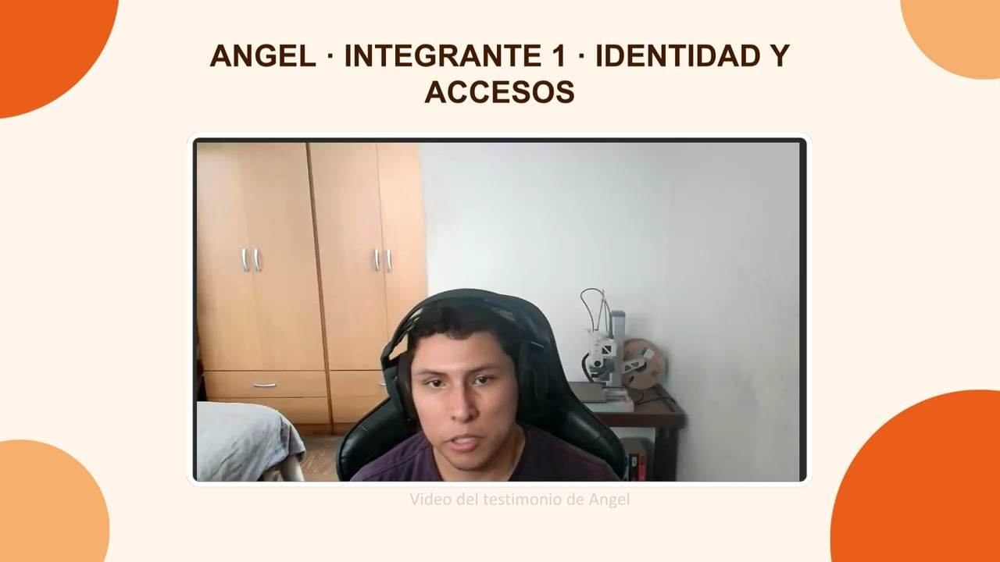

[← Capítulo V](50-chapter-5-product-implementation-validation-and-deployment.md) · [Contenido](../README.md#contenido) · [Bibliografía →](99-bibliography.md)

# Conclusiones

## Conclusiones y recomendaciones.

### Conclusiones

1. La aplicación de Event Storming y Domain-Driven Design permitió identificar 5 Bounded Contexts claros (Identidad y Accesos, Gestión de Flota, Operaciones y Rutas, Monitoreo IoT, Gestión de Incidencias), lo que hizo posible diseñar BottleTrack como un monolito modular con responsabilidades bien separadas, en lugar de un backend monolítico sin fronteras internas definidas.

2. El alcance del producto no fue estático durante el desarrollo: la eliminación del rol de Conductor como usuario de la plataforma obligó a actualizar en cascada las User Stories, el Product Backlog, el Class Diagram y los mock-ups ya construidos. Esto evidenció que mantener sincronizados los artefactos de diseño con las decisiones de negocio es tan importante como generarlos la primera vez.

3. El Sprint 1 mostró una brecha entre lo planificado y lo entregado (27 story points comprometidos frente a 8 realmente completados): el equipo priorizó cerrar la documentación técnica y la Landing Page, dejando las pantallas de identidad, usuarios y empresa solo a nivel de diseño en Figma, sin pasar a implementación.

4. La revisión de AV1 mostró que cumplir la forma exacta de cada artefacto pesa tanto como su contenido. Por ello, el equipo reescribió el Problem Statement con la plantilla Brand new initiative, completó el Lean UX Canvas, analizó las entrevistas con variables y porcentajes, reordenó el Product Backlog según el valor para el negocio y rehízo los diagramas de clases y de base de datos con una sola convención de nombres en inglés.

5. En el Sprint 3 la distribución del trabajo por bounded context se trasladó al backend: los Web Services implementan los cinco contextos con 39 endpoints y doce tablas en MySQL. La integración con la Web Application quedó parcial, por lo que las acciones de estado de las operaciones, el monitoreo en vivo y el seguimiento de la bodega pasan al Sprint 4 y se comunican en la aplicación con el aviso Próximamente.

6. Las entrevistas de validación confirmaron el valor de centralizar el seguimiento de las entregas y señalaron qué priorizar: estados y cantidades claros, avisos de retrasos, reclamos con fotografías y el uso desde el celular.

### Recomendaciones

1. Cerrar el diseño en Figma de cada pantalla *antes* de comprometerla en un sprint de implementación, para evitar que el tiempo de desarrollo se use en decisiones de diseño pendientes.

2. Recalibrar la Sprint Velocity del equipo usando el dato real del Sprint 1 (8 puntos) en lugar de la capacidad estimada inicialmente (27), y reservar explícitamente horas para trabajo de documentación en la planificación de los siguientes sprints, en vez de tratarlo como actividad paralela sin costo.

3. Mantener la trazabilidad entre las secciones del informe cada vez que cambia una decisión. Tras la revisión de AV1, el equipo alineó los segmentos objetivo, los User Personas, las User Stories, el Landing Page y la arquitectura alrededor de las mismas tres decisiones: tres segmentos, el conductor como actor que no usa la aplicación y el monitoreo IoT dentro del alcance con lecturas simuladas.

4. Desplegar los Web Services al inicio del Sprint 4 y publicar la Web Application integrada con ellos, para validar los flujos de los tres roles sobre la aplicación publicada y no solo en el entorno local.

5. Acordar y probar el contrato de cada endpoint junto con la vista que lo consume dentro del mismo Sprint, para que una funcionalidad implementada en el backend no quede sin integrar en la Web Application.

## Video About-the-Team.

El video About-the-Team presenta a los integrantes de CodeCrafters, su motivación para construir BottleTrack y la forma en que el equipo trabajó en cada Sprint, incluyendo los testimonios que sustentan el Student Outcome. Tiene una duración aproximada de 5 minutos más 1 minuto por integrante, se publica en Microsoft Stream y en YouTube, y se incrusta en la sección *The team* del Landing Page.

| Video | Nombre del archivo | Duración | URL |
| :---- | :----------------- | :------- | :-- |
| About-the-Team | upc-pre-202620-1asi0730-8084-codecrafters-about-the-team-sprint-3 | 06:45 | [Ver video en YouTube](https://youtu.be/jtTP8YT2dOU) |

| Inicio | Fin | Sección | Presenta |
| :----- | :-- | :------ | :------- |
| 00:00 | 00:27 | Presentación del equipo y de los tres productos | Crispin Valdivia, Angel Gabriel |
| 00:27 | 01:18 | Sprint 1: Landing Page | Palacin Lazo, Gerardo Valentin |
| 01:18 | 01:53 | Sprint 2: Frontend Web Application | Cumba Rengifo, Leonardo Raul |
| 01:53 | 02:24 | Sprint 3: Web Services | Crispin Valdivia, Angel Gabriel |
| 02:24 | 03:08 | Obstáculos y cómo los resolvimos | Pezo Castilla, Maria Jose |
| 03:08 | 03:48 | Comunicación y mejora continua | Palacin Lazo, Gerardo Valentin |
| 03:48 | 04:22 | Testimonio | Crispin Valdivia, Angel Gabriel |
| 04:22 | 05:23 | Testimonio | Cumba Rengifo, Leonardo Raul |
| 05:23 | 06:17 | Testimonio | Palacin Lazo, Gerardo Valentin |
| 06:17 | 06:45 | Testimonio | Pezo Castilla, Maria Jose |

---

[← Capítulo V](50-chapter-5-product-implementation-validation-and-deployment.md) · [Contenido](../README.md#contenido) · [Bibliografía →](99-bibliography.md)